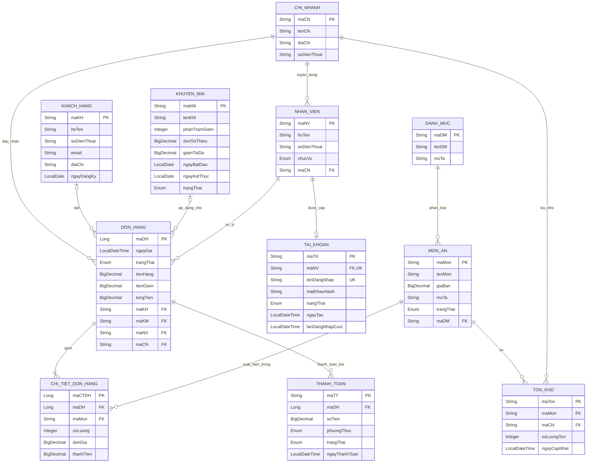

# MIS — HỆ THỐNG QUẢN LÝ CHUỖI CỬA HÀNG ĐỒ ĂN NHANH

| Mục | Nội dung |
|---|---|
| Đề tài | Hệ thống quản lý chuỗi cửa hàng đồ ăn nhanh (Fast Food Chain MIS) |
| Nhóm / Thành viên | **Nhóm 17**: Nguyễn Mai Thiên Quí (22110216), Nguyễn Quốc Tiên (22110244), Choi Minh Văn (22110264) |
| Công nghệ | Java 17+, IntelliJ IDEA, Maven |
| Phạm vi | 4 yêu cầu: (1) Phát biểu vấn đề + ERD, (2) Lớp Java, (3) Dữ liệu + Enum, (4) Truy vấn (mỗi thành viên 10 câu, chưa code) |

---

# MỤC LỤC

1. Phát biểu vấn đề và quy trình nghiệp vụ
2. Thực thể và thuộc tính
3. Mối liên kết và ERD
4. Ràng buộc nghiệp vụ
5. Enum và vòng đời trạng thái
6. Chuyển ER sang Java
7. Dữ liệu mẫu
8. Kiểm tra độ bao phủ dữ liệu
9. 30 câu truy vấn
10. Phân công

---

# 1. PHÁT BIỂU VẤN ĐỀ VÀ QUY TRÌNH NGHIỆP VỤ

## 1.1. Phát biểu vấn đề

Chuỗi cửa hàng đồ ăn nhanh bán hamburger, gà rán, pizza, khoai tây chiên, mì Ý, nước uống và combo tại nhiều chi nhánh. Hiện việc ghi đơn, tính tiền, theo dõi tồn kho và thống kê doanh thu thực hiện thủ công nên dễ sai sót và khó tổng hợp.

Mỗi chi nhánh còn có nhiều nhân viên với vai trò khác nhau (quản lý, thu ngân, nhân viên bán hàng), và có thêm bộ phận quản trị ở trụ sở. Nếu mọi người dùng chung hệ thống mà không phân biệt ai là ai thì không biết ai đã thực hiện nghiệp vụ, không giới hạn được thao tác theo chức vụ và không giới hạn được dữ liệu theo chi nhánh. Vì vậy mỗi nhân viên được **cấp một tài khoản** gắn với hồ sơ nhân sự của mình để đăng nhập, được phân quyền theo chức vụ và được truy vết khi thao tác.

Hệ thống MIS cần lưu trữ và truy xuất dữ liệu để trả lời các câu hỏi quản lý như:

- Món nào đang bán, món nào tồn kho dưới 10 tại từng chi nhánh?
- Tháng 02/2026 có bao nhiêu đơn đã hoàn thành?
- Doanh thu từng tháng, từng nhân viên, từng phương thức thanh toán là bao nhiêu?
- Ba món bán chạy nhất? Món nào chưa từng bán thành công?
- Khách hàng nào chưa từng đặt hàng?
- Mỗi chương trình khuyến mãi đã giảm tổng cộng bao nhiêu tiền? Chương trình nào chưa ai dùng?
- Nhân viên nào chưa được cấp tài khoản? Tài khoản nào đang bị khóa hoặc chưa từng đăng nhập?

## 1.2. Quy trình nghiệp vụ (xuất phát điểm của thiết kế)

**Nhánh 1 diễn ra trước và là điều kiện của nhánh 2**: nhân viên phải có hồ sơ và tài khoản thì mới đăng nhập và bán hàng được.

### 1.2.1. Nhánh 1 — Quản lý nhân sự và tài khoản

Khi có nhân viên mới, quy trình là “tạo hồ sơ trước, cấp tài khoản sau”:

```text
Tạo NhanVien
      ↓
Chọn ChucVu + ChiNhanh
      ↓
Tạo TaiKhoan gắn với NhanVien
      ↓
Sinh tenDangNhap
      ↓
Sinh mật khẩu tạm
      ↓
Lưu matKhauHash
      ↓
Bàn giao mật khẩu tạm
      ↓
Nhân viên đăng nhập lần đầu
      ↓
Bắt buộc đổi mật khẩu
```

**Bước 1 — Tạo nhân viên.** Người có quyền (xem mục 3.7) tạo hồ sơ nhân viên gồm: họ tên, số điện thoại, chức vụ, chi nhánh. Phải tạo `NhanVien` trước vì `TaiKhoan.maNV` là FK NOT NULL.

**Bước 2 — Tạo tài khoản.** Người có quyền tạo tài khoản cho nhân viên đó. Hệ thống:

1. Sinh `tenDangNhap`, ví dụ `nv08`.
2. Kiểm tra `tenDangNhap` không trùng.
3. Kiểm tra nhân viên chưa có tài khoản.
4. Sinh mật khẩu tạm ngẫu nhiên.
5. Băm mật khẩu và **chỉ lưu `matKhauHash`**.
6. Đặt `trangThai = ACTIVE`.
7. Đặt `ngayTao` = thời điểm hiện tại.
8. Đặt `lanDangNhapCuoi = NULL`.

**Bước 3 — Đăng nhập lần đầu.** Mật khẩu tạm chỉ được hiển thị **một lần** cho người tạo tài khoản để bàn giao cho nhân viên. Nhân viên đăng nhập bằng tài khoản được cấp. Nếu `lanDangNhapCuoi = NULL`, hệ thống hiểu đây là lần đăng nhập đầu tiên và yêu cầu đổi mật khẩu. Không cần thêm thuộc tính `mustChangePassword`.

> **Lưu ý thiết kế:** vì “bắt buộc đổi mật khẩu” dựa vào `lanDangNhapCuoi = NULL`, ở lần đăng nhập đầu hệ thống chỉ ghi `lanDangNhapCuoi` **sau khi đổi mật khẩu thành công**. Nếu nhân viên thoát giữa chừng, giá trị vẫn là NULL và lần sau vẫn bị buộc đổi.
>
> **Tài khoản ADMIN đầu tiên** (`admin01`) do hệ thống khởi tạo sẵn, vì khi chưa có ai thì chưa có người có quyền tạo tài khoản.

### 1.2.2. Nhánh 2 — Bán hàng

```text
Khách chọn món → Nhân viên tạo đơn → Thêm món vào đơn → Xác nhận/chuẩn bị → Thanh toán → Hoàn thành (hoặc Hủy)
```

| Bước | Diễn biến nghiệp vụ | Dữ liệu phát sinh | Trạng thái |
|---|---|---|---|
| 1 | Khách xem menu, chọn món đang bán (có thể là khách vãng lai). | Món ăn, Danh mục, Khách hàng (tùy chọn) | — |
| 2 | Nhân viên tại chi nhánh **đăng nhập bằng tài khoản của mình** rồi tạo đơn hàng; hệ thống tự gán nhân viên đang đăng nhập và chi nhánh của nhân viên đó cho đơn (TaiKhoan → NhanVien → ChiNhanh). | Đơn hàng (gắn Nhân viên, Chi nhánh, Khách hàng) | Đơn hàng: CHO_XAC_NHAN |
| 3 | Mỗi món khách chọn thành một dòng chi tiết; đơn giá được chốt tại thời điểm này; tính tiền hàng, áp dụng khuyến mãi hợp lệ (nếu có) để ra tiền giảm và tổng phải trả. | Chi tiết đơn hàng (số lượng, đơn giá, thành tiền); Khuyến mãi (tùy chọn) → tiền giảm, tổng tiền | — |
| 4 | Quản lý/nhân viên xác nhận, bếp chuẩn bị, món sẵn sàng giao. Tồn kho **của chi nhánh nhận đơn** giảm tương ứng. | Cập nhật Tồn kho (theo món + chi nhánh) | Đơn hàng: DA_XAC_NHAN → DANG_CHUAN_BI → SAN_SANG |
| 5 | Khách thanh toán bằng tiền mặt, chuyển khoản, ví điện tử hoặc thẻ (trả trước khi bếp chuẩn bị hoặc khi nhận món); có thể thất bại rồi thử lại. | Thanh toán (phương thức, trạng thái) | Thanh toán: CHO_THANH_TOAN → DA_THANH_TOAN / THAT_BAI |
| 6 | Giao món và đóng đơn; hoặc hủy đơn (hoàn tiền nếu đã thanh toán). | Đóng đơn / Hoàn tiền | Đơn hàng: DA_HOAN_THANH / DA_HUY; Thanh toán: DA_HOAN_TIEN |

> **Lưu ý:** thanh toán không nằm cố định sau bước `SAN_SANG`. Khách có thể trả ngay khi đơn được xác nhận (ví dụ đơn `1027`) hoặc trả khi nhận món (ví dụ đơn `1026` còn chờ thanh toán). Điều kiện bắt buộc duy nhất: đơn chỉ được `DA_HOAN_THANH` khi đã có thanh toán `DA_THANH_TOAN` đủ số tiền (BR14).

## 1.3. Từ quy trình suy ra thực thể

```text
Chuỗi bán hàng:
  Khách hàng → Đơn hàng → Chi tiết đơn hàng → Món ăn → Danh mục

Xử lý và thanh toán:
  Nhân viên → Đơn hàng        Chi nhánh → Nhân viên, Đơn hàng
  Đơn hàng ─── Thanh toán          Chi nhánh ─── Tồn kho ─── Món ăn
  Khuyến mãi ─── Đơn hàng

Quản lý nhân sự và truy cập:
  Nhân viên ─── Tài khoản     (hồ sơ trước, tài khoản sau; 1 – 0..1)
  Chức vụ của Nhân viên → quyền thao tác
  Chi nhánh của Nhân viên → phạm vi dữ liệu
```

| Danh từ trong nghiệp vụ | Thực thể | Động từ → Mối liên kết |
|---|---|---|
| Người mua | KhachHang | đặt (Khách hàng – Đơn hàng) |
| Cửa hàng | ChiNhanh | tuyển dụng / tiếp nhận (Chi nhánh – Nhân viên, Đơn hàng) |
| Người bán | NhanVien | xử lý (Nhân viên – Đơn hàng) |
| Tài khoản đăng nhập của nhân viên | TaiKhoan | được cấp cho (Nhân viên – Tài khoản) |
| Loại món | DanhMuc | phân loại (Danh mục – Món ăn) |
| Món | MonAn | xuất hiện trong (Món ăn – Chi tiết đơn) |
| Đơn khách đặt | DonHang | gồm (Đơn hàng – Chi tiết đơn) |
| Dòng món trong đơn | ChiTietDonHang | giải quyết quan hệ N-N Đơn hàng ↔ Món ăn |
| Thanh toán | ThanhToan | thanh toán cho (Đơn hàng – Thanh toán) |
| Số lượng còn lại của một món tại một chi nhánh | TonKho | lưu trữ (Chi nhánh – Tồn kho – Món ăn) |
| Chương trình giảm giá | KhuyenMai | áp dụng cho (Khuyến mãi – Đơn hàng) |

> **Phạm vi:** 11 thực thể (9 thực thể bán hàng + `KhuyenMai` + `TaiKhoan`). Khuyến mãi được áp dụng ở cấp đơn hàng, tối đa một chương trình cho mỗi đơn. `ChucVu` là Enum (thuộc tính của `NhanVien`), không phải thực thể; hệ thống không có thực thể Quyền/Role/Permission/DangNhap vì quyền được suy ra từ `NhanVien.chucVu`.

---

# 2. THỰC THỂ VÀ THUỘC TÍNH

Quy ước đọc bảng: **PK/FK** là *thuộc tính khóa*; các thuộc tính còn lại là *thuộc tính mô tả*. Cột “Ràng buộc” cho biết `NULL`/`NOT NULL`, `UNIQUE`, `CHECK`; cột “Ý nghĩa” giải thích vì sao chọn ràng buộc đó.

Tên bảng quan hệ của `DonHang` nên đặt là `don_hang`/`orders` (tránh từ khóa SQL `ORDER`).

## 2.1. Khách hàng — `KhachHang`

| Thuộc tính | Kiểu | Loại | Ràng buộc | Ý nghĩa |
|---|---|---|---|---|
| `maKH` | String | Khóa chính | PK, NOT NULL | Mã khách hàng (KH001…), định danh duy nhất. |
| `hoTen` | String | Mô tả | NOT NULL | Họ tên; cần có để biết người mua là ai. |
| `soDienThoai` | String | Mô tả | NOT NULL, UNIQUE | Dùng liên hệ/tra cứu; mỗi số chỉ thuộc một khách. |
| `email` | String | Mô tả | NULL, UNIQUE | Không bắt buộc; nếu có thì không được trùng (nhiều giá trị NULL vẫn hợp lệ). |
| `diaChi` | String | Mô tả | NULL | Khách có thể không muốn cung cấp. |
| `ngayDangKy` | LocalDate | Mô tả | NOT NULL | Ngày đăng ký, hệ thống tự gán khi tạo. |

## 2.2. Chi nhánh — `ChiNhanh`

| Thuộc tính | Kiểu | Loại | Ràng buộc | Ý nghĩa |
|---|---|---|---|---|
| `maCN` | String | Khóa chính | PK, NOT NULL | Mã chi nhánh (CN01…). |
| `tenCN` | String | Mô tả | NOT NULL | Tên chi nhánh. |
| `diaChi` | String | Mô tả | NOT NULL | Địa chỉ bắt buộc để khách và nhân viên xác định cửa hàng. |
| `soDienThoai` | String | Mô tả | NOT NULL, UNIQUE | Số liên hệ của chi nhánh, không trùng giữa các chi nhánh. |

## 2.3. Nhân viên — `NhanVien`

| Thuộc tính | Kiểu | Loại | Ràng buộc | Ý nghĩa |
|---|---|---|---|---|
| `maNV` | String | Khóa chính | PK, NOT NULL | Mã nhân viên (NV01…). |
| `hoTen` | String | Mô tả | NOT NULL | Họ tên nhân viên. |
| `soDienThoai` | String | Mô tả | NOT NULL, UNIQUE | Số liên hệ, không trùng. |
| `chucVu` | ChucVu (Enum) | Mô tả | NOT NULL | Chức vụ (quản trị/quản lý/thu ngân/nhân viên); ai cũng phải có một chức vụ. Đây là căn cứ **xác định quyền** của tài khoản. |
| `maCN` | String | Khóa ngoại | FK → ChiNhanh, NOT NULL | Nhân viên bắt buộc thuộc một chi nhánh (ADMIN thuộc `CN00` – Trụ sở). Đây cũng là chi nhánh của tài khoản nhân viên đó. |

## 2.4. Danh mục món ăn — `DanhMuc`

| Thuộc tính | Kiểu | Loại | Ràng buộc | Ý nghĩa |
|---|---|---|---|---|
| `maDM` | String | Khóa chính | PK, NOT NULL | Mã danh mục (DM01…). |
| `tenDM` | String | Mô tả | NOT NULL, UNIQUE | Tên danh mục, không trùng. |
| `moTa` | String | Mô tả | NULL | Mô tả thêm, không bắt buộc. |

## 2.5. Món ăn — `MonAn`

| Thuộc tính | Kiểu | Loại | Ràng buộc | Ý nghĩa |
|---|---|---|---|---|
| `maMon` | String | Khóa chính | PK, NOT NULL | Mã món (M001…). |
| `tenMon` | String | Mô tả | NOT NULL | Tên món hiển thị trên menu. |
| `giaBan` | BigDecimal | Mô tả | NOT NULL, CHECK > 0 | Giá bán hiện tại; phải dương. Giá lịch sử nằm ở chi tiết đơn. |
| `moTa` | String | Mô tả | NULL | Không phải món nào cũng cần mô tả. |
| `trangThai` | TrangThaiMon (Enum) | Mô tả | NOT NULL | Đang bán / ngừng bán. |
| `maDM` | String | Khóa ngoại | FK → DanhMuc, NOT NULL | Mỗi món thuộc đúng một danh mục. |

## 2.6. Tồn kho theo chi nhánh — `TonKho`

| Thuộc tính | Kiểu | Loại | Ràng buộc | Ý nghĩa |
|---|---|---|---|---|
| `maTon` | String | Khóa chính | PK, NOT NULL | Mã bản ghi tồn kho (T001…). |
| `maMon` | String | Khóa ngoại | FK → MonAn, NOT NULL | Tồn kho này là của món nào. |
| `maCN` | String | Khóa ngoại | FK → ChiNhanh, NOT NULL | Tồn kho này đang nằm tại chi nhánh nào. |
| `soLuongTon` | Integer | Mô tả | NOT NULL, CHECK >= 0 | Số lượng còn lại của món tại chi nhánh, không được âm. |
| `ngayCapNhat` | LocalDateTime | Mô tả | NOT NULL | Thời điểm cập nhật gần nhất. |
| `UNIQUE` |  | — | UNIQUE (maMon, maCN) | Mỗi món tại mỗi chi nhánh chỉ có một dòng tồn kho hiện tại. |

`TonKho` là thực thể trung gian giải quyết quan hệ N – N giữa `MonAn` và `ChiNhanh` (xem mục 3.4). `CN00 – Trụ sở` không bán hàng nên không có dòng tồn kho.

## 2.7. Khuyến mãi — `KhuyenMai`

| Thuộc tính | Kiểu | Loại | Ràng buộc | Ý nghĩa |
|---|---|---|---|---|
| `maKM` | String | Khóa chính | PK, NOT NULL | Mã khuyến mãi (KM01…). |
| `tenKM` | String | Mô tả | NOT NULL | Tên chương trình hiển thị cho khách. |
| `phanTramGiam` | Integer | Mô tả | NOT NULL, CHECK BETWEEN 1 AND 100 | Phần trăm giảm trên tiền hàng. |
| `donToiThieu` | BigDecimal | Mô tả | NOT NULL, CHECK >= 0 | Giá trị đơn tối thiểu để được giảm; 0 nghĩa là không yêu cầu. |
| `giamToiDa` | BigDecimal | Mô tả | NULL, CHECK > 0 | Mức giảm tối đa; NULL nghĩa là không giới hạn. |
| `ngayBatDau` | LocalDate | Mô tả | NOT NULL | Ngày bắt đầu hiệu lực. |
| `ngayKetThuc` | LocalDate | Mô tả | NOT NULL, CHECK >= ngayBatDau | Ngày kết thúc, không được trước ngày bắt đầu. |
| `trangThai` | TrangThaiKhuyenMai (Enum) | Mô tả | NOT NULL | Đang áp dụng / tạm dừng / hết hạn. |

## 2.8. Đơn hàng — `DonHang`

| Thuộc tính | Kiểu | Loại | Ràng buộc | Ý nghĩa |
|---|---|---|---|---|
| `maDH` | Long | Khóa chính | PK, NOT NULL | Mã đơn (1001…), tự tăng. |
| `ngayDat` | LocalDateTime | Mô tả | NOT NULL | Thời điểm tạo đơn; cần cho thống kê theo tháng. |
| `trangThai` | TrangThaiDonHang (Enum) | Mô tả | NOT NULL, default CHO_XAC_NHAN | Trạng thái xử lý, mặc định mới tạo là chờ xác nhận. |
| `tienHang` | BigDecimal | Mô tả | NOT NULL, CHECK >= 0 | Tiền hàng = tổng thành tiền các dòng chi tiết (thuộc tính suy diễn, lưu để báo cáo nhanh). |
| `tienGiam` | BigDecimal | Mô tả | NOT NULL, CHECK >= 0, default 0 | Tiền giảm do khuyến mãi; bằng 0 khi đơn không dùng khuyến mãi. |
| `tongTien` | BigDecimal | Mô tả | NOT NULL, CHECK >= 0 | Tổng phải trả = tiền hàng − tiền giảm; là số dùng tính doanh thu và thanh toán. |
| `maKH` | String | Khóa ngoại | FK → KhachHang, NULL | NULL cho khách vãng lai không đăng ký. |
| `maKM` | String | Khóa ngoại | FK → KhuyenMai, NULL | NULL khi đơn không dùng khuyến mãi; mỗi đơn dùng tối đa 1 khuyến mãi. |
| `maNV` | String | Khóa ngoại | FK → NhanVien, NOT NULL | Đơn luôn có nhân viên chịu trách nhiệm. |
| `maCN` | String | Khóa ngoại | FK → ChiNhanh, NOT NULL | Đơn luôn phát sinh tại một chi nhánh. |

## 2.9. Chi tiết đơn hàng — `ChiTietDonHang`

| Thuộc tính | Kiểu | Loại | Ràng buộc | Ý nghĩa |
|---|---|---|---|---|
| `maCTDH` | Long | Khóa chính | PK, NOT NULL | Khóa thay thế (surrogate) cho từng dòng chi tiết. |
| `maDH` | Long | Khóa ngoại | FK → DonHang, NOT NULL | Dòng này thuộc đơn nào. |
| `maMon` | String | Khóa ngoại | FK → MonAn, NOT NULL | Dòng này là món nào. |
| `soLuong` | Integer | Mô tả | NOT NULL, CHECK > 0 | Số lượng mua, phải ≥ 1. |
| `donGia` | BigDecimal | Mô tả | NOT NULL, CHECK >= 0 | Giá tại thời điểm mua (sao chép từ giá món lúc đặt), không đổi khi giá món thay đổi. |
| `thanhTien` | BigDecimal | Mô tả | NOT NULL, = soLuong × donGia | Thành tiền của dòng (thuộc tính suy diễn). |
| `UNIQUE` |  | — | UNIQUE (maDH, maMon) | Một món chỉ xuất hiện một dòng trong một đơn; mua thêm thì tăng số lượng. |

## 2.10. Thanh toán — `ThanhToan`

| Thuộc tính | Kiểu | Loại | Ràng buộc | Ý nghĩa |
|---|---|---|---|---|
| `maTT` | String | Khóa chính | PK, NOT NULL | Mã giao dịch thanh toán (TT001…). |
| `maDH` | Long | Khóa ngoại | FK → DonHang, NOT NULL | Thanh toán cho đơn nào. |
| `soTien` | BigDecimal | Mô tả | NOT NULL, CHECK > 0 | Số tiền của giao dịch. |
| `phuongThuc` | PhuongThucThanhToan (Enum) | Mô tả | NOT NULL | Tiền mặt / chuyển khoản / ví điện tử / thẻ. |
| `trangThai` | TrangThaiThanhToan (Enum) | Mô tả | NOT NULL | Chờ / đã thanh toán / thất bại / đã hoàn tiền. |
| `ngayThanhToan` | LocalDateTime | Mô tả | NULL | NULL khi còn chờ thanh toán (chưa phát sinh giao dịch). |

## 2.11. Tài khoản — `TaiKhoan`

| Thuộc tính | Kiểu | Loại | Ràng buộc | Ý nghĩa |
|---|---|---|---|---|
| `maTK` | String | Khóa chính | PK, NOT NULL | Mã tài khoản (TK01…), cùng convention `String` với các bảng danh mục khác. |
| `maNV` | String | Khóa ngoại | FK → NhanVien, NOT NULL, UNIQUE | Nhân viên sở hữu tài khoản. NOT NULL vì tài khoản phải thuộc đúng một nhân viên; UNIQUE để mỗi nhân viên tối đa một tài khoản. |
| `tenDangNhap` | String | Mô tả | NOT NULL, UNIQUE | Tên đăng nhập, duy nhất toàn hệ thống (ví dụ `nv02`). |
| `matKhauHash` | String | Mô tả | NOT NULL | Mật khẩu **đã băm**. Không lưu mật khẩu dạng plaintext. |
| `trangThai` | TrangThaiTaiKhoan (Enum) | Mô tả | NOT NULL | `ACTIVE` / `LOCKED`. |
| `ngayTao` | LocalDateTime | Mô tả | NOT NULL | Thời điểm tạo tài khoản, hệ thống tự gán. |
| `lanDangNhapCuoi` | LocalDateTime | Mô tả | NULL | Lần đăng nhập gần nhất; NULL nghĩa là chưa từng đăng nhập (lần đăng nhập đầu sẽ bị buộc đổi mật khẩu). |

`TaiKhoan` **không có cột `maCN`**: chi nhánh của tài khoản được suy ra qua `TaiKhoan → NhanVien → ChiNhanh` (giải thích ở mục 3.5). Tài khoản chỉ dành cho nhân viên; khách hàng không đăng nhập hệ thống.

---

# 3. MỐI LIÊN KẾT VÀ ERD

## 3.1. Bảng mối liên kết

| Thực thể A | Liên kết | Thực thể B | Cardinality | Tham gia / Ghi chú |
|---|---|---|---|---|
| ChiNhanh | tuyển dụng | NhanVien | 1 – N | Nhân viên bắt buộc thuộc 1 chi nhánh. |
| ChiNhanh | tiếp nhận | DonHang | 1 – N | Đơn bắt buộc thuộc 1 chi nhánh. |
| KhachHang | đặt | DonHang | 1 – N | Khách có thể chưa có đơn (0..N); đơn có thể không có khách (khách vãng lai). |
| KhuyenMai | áp dụng cho | DonHang | 1 – N | Khuyến mãi có thể chưa ai dùng (0..N); đơn có thể không dùng khuyến mãi (0..1). Khóa ngoại `maKM` đặt ở `DonHang`. |
| NhanVien | xử lý | DonHang | 1 – N | Mỗi đơn có đúng 1 nhân viên; nhân viên có thể chưa xử lý đơn nào. |
| NhanVien | được cấp | TaiKhoan | 1 – 0..1 | Nhân viên có thể chưa có tài khoản (0) và có tối đa 1 tài khoản; tài khoản bắt buộc thuộc đúng 1 nhân viên. Khóa ngoại `maNV` đặt ở `TaiKhoan`, NOT NULL + UNIQUE. **Chi nhánh của tài khoản suy ra qua `TaiKhoan → NhanVien → ChiNhanh`, không nối `TaiKhoan` với `ChiNhanh`.** |
| NhanVien | có (chức vụ) | ChucVu (Enum) | N – 1 | `ChucVu` là Enum nên được lưu trực tiếp thành thuộc tính `NhanVien.chucVu`, không tạo thực thể riêng. Quyền suy ra qua `TaiKhoan → NhanVien → chucVu`. |
| DanhMuc | phân loại | MonAn | 1 – N | Mỗi món thuộc đúng 1 danh mục. |
| ChiNhanh | lưu kho | TonKho | 1 – N | Mỗi dòng tồn kho thuộc đúng 1 chi nhánh bán hàng; chi nhánh có nhiều dòng tồn kho (một dòng cho mỗi món). |
| MonAn | có | TonKho | 1 – N | Mỗi dòng tồn kho thuộc đúng 1 món; một món có tối đa một dòng tồn kho tại mỗi chi nhánh (UNIQUE `maMon`, `maCN`). |
| MonAn ↔ ChiNhanh | tồn kho (gián tiếp) |  | N – N | Được giải quyết bằng thực thể trung gian TonKho (mang thuộc tính `soLuongTon`). |
| DonHang | gồm | ChiTietDonHang | 1 – N | Đơn có ít nhất 1 dòng chi tiết. |
| MonAn | xuất hiện trong | ChiTietDonHang | 1 – N | Món có thể chưa từng được bán. |
| DonHang | được thanh toán bởi | ThanhToan | 1 – N | Một đơn có thể có nhiều lần thử thanh toán (thất bại rồi thử lại); tối đa 1 lần `DA_THANH_TOAN`. |
| DonHang ↔ MonAn | gồm (gián tiếp) |  | N – N | Được giải quyết bằng thực thể trung gian ChiTietDonHang. |

## 3.2. Giải quyết quan hệ N-N

```text
DonHang N ───── N MonAn      (không triển khai trực tiếp)

DonHang 1 ───── N ChiTietDonHang N ───── 1 MonAn
```

`ChiTietDonHang` là thực thể quan trọng vì nó mang thông tin riêng của mối liên kết: số lượng, đơn giá tại thời điểm mua, thành tiền. Ví dụ Burger Bò có giá 45.000 trong các đơn tháng 1–5 và 50.000 từ tháng 6; nếu doanh thu được tính theo `MonAn.giaBan` hiện tại thì lịch sử doanh thu sẽ sai.

## 3.3. Quyết định thiết kế: liên kết KhuyenMai – DonHang

Nhóm chọn quan hệ **1 – N**, khóa ngoại `maKM` đặt tại `DonHang` và cho phép NULL.

```text
KhuyenMai 1 ───── N DonHang      (FK maKM nằm ở DonHang, NULL)
```

| Nội dung | Quyết định của nhóm | Căn cứ |
|---|---|---|
| Vị trí khóa ngoại | `DonHang.maKM` | Một khuyến mãi áp dụng cho nhiều đơn nên khóa ngoại nằm ở phía N. |
| Tính bắt buộc | Không bắt buộc (NULL) | Đa số đơn không dùng khuyến mãi (17/28 đơn trong dữ liệu mẫu). |
| Dạng quan hệ | 1 – N, không dùng N – N | Quy tắc nghiệp vụ: mỗi đơn dùng tối đa một khuyến mãi. Nếu sau này cho cộng dồn thì bổ sung thực thể trung gian `DonHang_KhuyenMai`. |
| Nơi lưu tiền giảm | `DonHang.tienGiam` | Lưu số tiền thực tế đã giảm để doanh thu không bị sai khi tỷ lệ khuyến mãi được sửa; cùng nguyên tắc với `donGia`. |
| Phạm vi áp dụng | Cấp đơn hàng | Chưa nối `KhuyenMai` với `MonAn`/`DanhMuc`; giảm theo món là hướng mở rộng. |

## 3.4. Quyết định thiết kế: tồn kho theo từng chi nhánh

Đề tài là chuỗi nhiều chi nhánh và mỗi chi nhánh có kho riêng. Nếu chỉ lưu một số tồn cho mỗi món trên toàn hệ thống (`MonAn 1 – 1 TonKho`) thì các chi nhánh dùng chung một con số: một đơn tại chi nhánh này làm giảm tồn của chi nhánh khác, và không trả lời được câu hỏi "món nào sắp hết **tại chi nhánh nào**". Vì vậy nhóm lưu tồn kho theo cặp (món, chi nhánh):

```text
MonAn N ───── N ChiNhanh      (không triển khai trực tiếp)

MonAn 1 ───── N TonKho N ───── 1 ChiNhanh
```

| Nội dung | Quyết định của nhóm | Căn cứ |
|---|---|---|
| Vị trí khóa ngoại | `maMon` và `maCN` cùng nằm ở `TonKho` | `TonKho` mang thuộc tính riêng của cặp (món, chi nhánh) là `soLuongTon`, giống vai trò của `ChiTietDonHang` với cặp (đơn, món). |
| Chi nhánh trụ sở `CN00` | Không có dòng tồn kho | `CN00` chỉ có nhân sự quản trị và không bán hàng (BR-TK-12). |
| Khi đơn được xác nhận | Trừ tồn tại `TonKho` của (món, **chi nhánh của đơn**) | Tồn kho mỗi chi nhánh biến động độc lập (BR23). |
| Quan hệ 1 – 1 trong mô hình | Chỉ còn dạng 1 – 0..1 (`NhanVien` – `TaiKhoan`) | `MonAn` – `TonKho` không còn là 1 – 1. |

## 3.5. Quyết định thiết kế: liên kết TaiKhoan – NhanVien

Nhóm chọn quan hệ **1 – 0..1**, khóa ngoại `maNV` đặt tại `TaiKhoan` (NOT NULL, UNIQUE) và **không** nối `TaiKhoan` với `ChiNhanh`.

```text
NhanVien 1 ───── 0..1 TaiKhoan      (FK maNV nằm ở TaiKhoan: NOT NULL + UNIQUE)

Chi nhánh của tài khoản : TaiKhoan → NhanVien → ChiNhanh
Quyền của tài khoản     : TaiKhoan → NhanVien → chucVu (Enum ChucVu)
```

| Nội dung | Quyết định của nhóm | Căn cứ |
|---|---|---|
| Vị trí khóa ngoại | `TaiKhoan.maNV` | Hồ sơ nhân viên có trước, tài khoản cấp sau và tham chiếu về nhân viên. Đặt `maTK` trong `NhanVien` sẽ buộc mọi nhân viên chưa có tài khoản mang cột NULL. |
| Dạng quan hệ | 1 – 0..1 | Quy trình "tạo hồ sơ trước, cấp tài khoản sau" làm nhân viên có thể tồn tại mà chưa có tài khoản; ngược lại tài khoản không thể tồn tại thiếu nhân viên nên `maNV` NOT NULL. |
| Giới hạn một tài khoản mỗi nhân viên | `maNV` UNIQUE | Cùng kỹ thuật UNIQUE như `UNIQUE (maMon, maCN)` ở `TonKho`. |
| Chi nhánh của tài khoản | Không có `TaiKhoan.maCN` | Chi nhánh đã nằm ở `NhanVien.maCN`; lưu thêm ở `TaiKhoan` sẽ trùng dữ liệu và có thể mâu thuẫn. |
| Quyền truy cập | Không tạo thực thể Role/Permission/DangNhap | Quyền suy ra từ `NhanVien.chucVu` (Enum cố định 4 giá trị); việc đăng nhập được ghi nhận bằng `lanDangNhapCuoi`. |
| Chi nhánh của ADMIN | `CN00 – Trụ sở` (cách A) | `NhanVien.maCN` là NOT NULL nên ADMIN cần một chi nhánh hợp lệ; ADMIN vẫn có quyền trên toàn hệ thống. `CN00` không có đơn hàng. |

## 3.6. Vai trò của TaiKhoan trong hệ thống

`TaiKhoan` được đưa vào mô hình để đáp ứng ba yêu cầu quản lý của hệ thống MIS.

| Yêu cầu | Cách hệ thống đáp ứng | Minh chứng trong dữ liệu mẫu |
|---|---|---|
| Xác định người thực hiện nghiệp vụ | Sau khi đăng nhập, hệ thống xác định `TaiKhoan → NhanVien → ChiNhanh` và tự gán `maNV`, `maCN` cho đơn mới. | `nv02` đăng nhập → NV02 thuộc CN01 → đơn 1020 có `maNV = NV02`, `maCN = CN01`. |
| Kiểm soát quyền và phạm vi dữ liệu | Chức vụ quyết định thao tác được phép; chi nhánh quyết định dữ liệu được xem (mục 3.7). | `THU_NGAN` xác nhận thanh toán; `QUAN_LY` xem báo cáo chi nhánh mình; `ADMIN` xem toàn hệ thống. |
| Truy vết người thực hiện | Mỗi đơn gắn với `maNV`; khi nhân viên nghỉ việc, tài khoản chuyển `LOCKED` thay vì bị xóa (BR-TK-11). | Đơn 1018 (đã hủy) thuộc NV02; tài khoản `nv04` bị khóa nhưng vẫn truy được 5 đơn đã xử lý. |

- **Phạm vi truy vết:** mô hình ghi nhận người phụ trách ở cấp đơn hàng (`DonHang.maNV`). Việc ghi từng thao tác nhỏ (ai bấm hủy, ai xác nhận thanh toán, lúc nào) cần thêm nhật ký thao tác (audit log), nằm ngoài phạm vi đề tài.
- **Phân tách dữ liệu:** `NhanVien` lưu thông tin nhân sự (họ tên, số điện thoại, chức vụ, chi nhánh); `TaiKhoan` lưu thông tin xác thực và trạng thái truy cập. Hai thực thể tách riêng để phù hợp quy trình cấp tài khoản sau khi đã có hồ sơ.

## 3.7. Phân quyền theo chức vụ

Không tạo thực thể quyền riêng. Quyền được xác định bằng `TaiKhoan → NhanVien → ChucVu` và được kiểm tra ở tầng ứng dụng.

| Chức vụ | Quyền |
|---|---|
| `ADMIN` | Quản lý toàn bộ hệ thống và nhân viên thuộc mọi chi nhánh |
| `QUAN_LY` | Quản lý dữ liệu và nhân viên thuộc chi nhánh của mình |
| `THU_NGAN` | Thực hiện nghiệp vụ thu ngân tại chi nhánh của mình |
| `NHAN_VIEN` | Thực hiện các nghiệp vụ được phép tại chi nhánh của mình |

Quyền tạo tài khoản (hồ sơ nhân viên mới được tạo bởi cùng đối tượng và theo cùng phạm vi):

| Người tạo | Được tạo tài khoản cho |
|---|---|
| `ADMIN` | Nhân viên thuộc mọi chi nhánh, bao gồm `QUAN_LY` |
| `QUAN_LY` | Nhân viên thuộc chi nhánh của mình, **không** được tạo tài khoản cho `QUAN_LY` hoặc `ADMIN` |
| `THU_NGAN` | Không được tạo tài khoản |
| `NHAN_VIEN` | Không được tạo tài khoản |

**Chi nhánh trụ sở (cách A):** thêm `CN00 – Trụ sở` để ADMIN có chi nhánh hợp lệ. ADMIN được xem là nhân sự thuộc `CN00` nhưng có quyền trên toàn hệ thống. Vì vậy **không cần cột `maCN` trong `TaiKhoan`**: phạm vi dữ liệu của mọi tài khoản luôn lấy từ `NhanVien.maCN`.

## 3.8. Các loại quan hệ trong mô hình

| Loại | Có trong mô hình |
|---|---|
| 1 – 1 | Không có quan hệ 1 – 1 thuần; dạng một-một duy nhất là 1 – 0..1 bên dưới |
| 1 – 0..1 | NhanVien – TaiKhoan |
| 1 – N | Chi nhánh–Nhân viên, Chi nhánh–Đơn hàng, Khách hàng–Đơn hàng, Khuyến mãi–Đơn hàng, Nhân viên–Đơn hàng, Danh mục–Món ăn, Đơn hàng–Chi tiết, Món ăn–Chi tiết, Đơn hàng–Thanh toán, Chi nhánh–Tồn kho, Món ăn–Tồn kho |
| N – N | DonHang ↔ MonAn → ChiTietDonHang; MonAn ↔ ChiNhanh → TonKho |
| Quan hệ 2 ngôi | Tất cả các liên kết trên đều là quan hệ 2 ngôi. |
| Quan hệ 3 ngôi | Không cần: “nhân viên A bán món B trong đơn C” đã được biểu diễn bởi Đơn hàng.maNV và ChiTiết.maMon. |

## 3.9. ERD

ERD dạng Mermaid (xem được trên GitHub, IntelliJ có plugin Mermaid; có thể xuất ra hình để nộp).



Chú thích ký hiệu: `||` đúng một; `|o` / `o|` không hoặc một; `o{` không hoặc nhiều; `|{` một hoặc nhiều. `UK` là UNIQUE.

`TAI_KHOAN` chỉ nối với `NHAN_VIEN` (`maNV` vừa là FK vừa UNIQUE, NOT NULL). Không nối `TAI_KHOAN` với `CHI_NHANH` vì chi nhánh suy ra qua `NHAN_VIEN`.

---

# 4. RÀNG BUỘC NGHIỆP VỤ

| Mã | Quy tắc | Loại | Giải thích |
|---|---|---|---|
| BR01 | MonAn.giaBan > 0 | CHECK | Giá bán phải dương. |
| BR02 | ChiTietDonHang.soLuong > 0 | CHECK | Mỗi dòng mua ít nhất 1. |
| BR03 | ChiTietDonHang.donGia >= 0 | CHECK | Cho phép 0 (ví dụ món tặng kèm). |
| BR04 | ChiTietDonHang.thanhTien = soLuong × donGia | Suy diễn | Thành tiền luôn tính từ số lượng và đơn giá. |
| BR05 | DonHang.tienHang = SUM(ChiTietDonHang.thanhTien) | Suy diễn | Tiền hàng bằng tổng các dòng chi tiết. |
| BR06 | KhachHang.soDienThoai UNIQUE | UNIQUE | Mỗi số điện thoại chỉ thuộc một khách. |
| BR07 | KhachHang.email UNIQUE | UNIQUE | Nếu có email thì không trùng (NULL được phép lặp). |
| BR08 | NhanVien.soDienThoai, ChiNhanh.soDienThoai, DanhMuc.tenDM UNIQUE | UNIQUE | Không trùng lặp danh tính liên hệ / tên danh mục. |
| BR09 | UNIQUE(ChiTietDonHang.maDH, ChiTietDonHang.maMon) | UNIQUE | Một món chỉ một dòng trong một đơn. |
| BR10 | TonKho.soLuongTon >= 0 và UNIQUE (TonKho.maMon, TonKho.maCN) | CHECK + UNIQUE | Tồn kho không âm; mỗi món tại mỗi chi nhánh chỉ có một dòng tồn kho. |
| BR11 | ThanhToan.soTien > 0; mỗi đơn có tối đa 1 thanh toán trạng thái DA_THANH_TOAN | CHECK + Nghiệp vụ | Cho phép nhiều lần thử, nhưng chỉ một lần thành công. |
| BR12 | Nhân viên của đơn phải thuộc cùng chi nhánh với đơn | Liên bảng | Kiểm tra ở tầng ứng dụng. ADMIN thuộc `CN00` nên không phụ trách đơn (xem BR-TK-12). |
| BR13 | `donGia` được sao chép từ `MonAn.giaBan` khi tạo dòng và không đổi về sau | Nghiệp vụ | Bảo toàn lịch sử doanh thu. |
| BR14 | Đơn `DA_HOAN_THANH` phải có một thanh toán `DA_THANH_TOAN` với số tiền bằng tổng đơn | Liên bảng | Không đóng đơn khi chưa thu tiền. |
| BR15 | Thanh toán `DA_HOAN_TIEN` chỉ dành cho đơn `DA_HUY` | Liên bảng | Hoàn tiền chỉ phát sinh khi hủy đơn đã trả tiền. |
| BR16 | DonHang.ngayDat >= KhachHang.ngayDangKy | Liên bảng | Khách phải đăng ký trước hoặc cùng ngày khi đặt (nếu là khách đã đăng ký). |
| BR17 | DonHang.tongTien = DonHang.tienHang − DonHang.tienGiam; tienGiam >= 0; tongTien >= 0 | CHECK + Suy diễn | Tổng phải trả là số dùng cho doanh thu. |
| BR18 | KhuyenMai.phanTramGiam BETWEEN 1 AND 100; KhuyenMai.donToiThieu >= 0; KhuyenMai.giamToiDa > 0 hoặc NULL | CHECK | Tham số khuyến mãi hợp lệ. |
| BR19 | KhuyenMai.ngayKetThuc >= KhuyenMai.ngayBatDau | CHECK | Khoảng hiệu lực hợp lệ. |
| BR20 | Đơn không dùng khuyến mãi (`maKM` NULL) thì `tienGiam` = 0. Đơn có khuyến mãi thì `tienHang` >= `donToiThieu` và `tienGiam` = MIN(`tienHang` × `phanTramGiam` / 100, `giamToiDa`); nếu `giamToiDa` NULL thì không chặn trần | Liên bảng | Công thức giảm giá thống nhất. |
| BR21 | KhuyenMai.ngayBatDau <= DonHang.ngayDat <= KhuyenMai.ngayKetThuc | Liên bảng | Chỉ áp dụng khuyến mãi trong thời gian hiệu lực. |
| BR22 | Số tiền của thanh toán `DA_THANH_TOAN` = `DonHang.tongTien` (sau giảm giá) | Liên bảng | Khách trả đúng số tiền sau giảm. |
| BR23 | Khi đơn được xác nhận, trừ `soLuongTon` của `TonKho` có `maMon` = món trong đơn và `maCN` = chi nhánh của đơn; `CN00` không có `TonKho` | Liên bảng | Tồn kho mỗi chi nhánh độc lập; không để một chi nhánh trừ tồn của chi nhánh khác. |
| BR-TK-01 | Một nhân viên có tối đa một tài khoản | Quan hệ 1 – 0..1 | Nhân viên có thể chưa có tài khoản nhưng không có hai. |
| BR-TK-02 | Một tài khoản bắt buộc thuộc về một nhân viên | NOT NULL + FK | `TaiKhoan.maNV` NOT NULL, tham chiếu `NhanVien.maNV`. |
| BR-TK-03 | `TaiKhoan.tenDangNhap` phải duy nhất trong toàn hệ thống | UNIQUE | Hai người không thể dùng chung tên đăng nhập. |
| BR-TK-04 | `TaiKhoan.maNV` phải duy nhất | UNIQUE | Kỹ thuật bảo đảm BR-TK-01. |
| BR-TK-05 | Nhân viên không tự đăng ký tài khoản | Nghiệp vụ | Tài khoản do người có quyền cấp sau khi đã có hồ sơ nhân viên. |
| BR-TK-06 | Chỉ `ADMIN` hoặc `QUAN_LY` có quyền tạo tài khoản | Phân quyền | `THU_NGAN`, `NHAN_VIEN` không được tạo. |
| BR-TK-07 | `QUAN_LY` chỉ được tạo tài khoản cho nhân viên thuộc chi nhánh của mình | Phân quyền / Liên bảng | So `maCN` của người tạo với `maCN` của nhân viên được cấp (kiểm tra ở tầng ứng dụng). |
| BR-TK-08 | `QUAN_LY` không được tạo tài khoản cho `ADMIN` hoặc `QUAN_LY` khác | Phân quyền | Chỉ `ADMIN` được cấp tài khoản cho `QUAN_LY`. |
| BR-TK-09 | Mật khẩu không được lưu dạng plaintext | Bảo mật | Chỉ lưu `matKhauHash`. |
| BR-TK-10 | Nhân viên đăng nhập lần đầu (`lanDangNhapCuoi` = NULL) phải đổi mật khẩu | Nghiệp vụ | Không cần thuộc tính `mustChangePassword`; `lanDangNhapCuoi` chỉ được ghi sau khi đổi mật khẩu thành công. |
| BR-TK-11 | Khi nhân viên nghỉ việc, không xóa tài khoản nếu tài khoản đã tham gia tạo/xử lý dữ liệu nghiệp vụ; chuyển `trangThai = LOCKED` | Nghiệp vụ | Giữ khả năng truy vết người thực hiện các đơn cũ. |
| BR-TK-12 | Nhân viên có `chucVu = ADMIN` thuộc `CN00`; `CN00` không phát sinh đơn hàng | Liên bảng | Cách A về chi nhánh trụ sở; ADMIN quản trị chứ không trực tiếp bán hàng (khớp BR12). |

Trong Java, các quy tắc CHECK được kiểm tra ngay trong constructor/setter thông qua lớp tiện ích `Rule` (xem mục 6); quy tắc liên bảng (BR12, BR14, BR15, BR16, BR20–BR23, BR-TK-01, BR-TK-12) được kiểm tra trong constructor và phương thức nghiệp vụ của `DonHang`, `TonKho`, `ThanhToan`, `TaiKhoan`, `NhanVien`; riêng UNIQUE của `tenDangNhap` được kiểm tra khi nạp dữ liệu mẫu.

---

# 5. ENUM VÀ VÒNG ĐỜI TRẠNG THÁI

## 5.1. Vòng đời đơn hàng

```text
CHO_XAC_NHAN → DA_XAC_NHAN → DANG_CHUAN_BI → SAN_SANG → DA_HOAN_THANH
   │              │               │
   └──────────────┴───────────────┴──→ DA_HUY
```

Chỉ được chuyển tiến theo chiều mũi tên; `DA_HUY` chỉ áp dụng trước khi `SAN_SANG`; `DA_HOAN_THANH` và `DA_HUY` là trạng thái cuối. Thanh toán độc lập với chuỗi này: có thể diễn ra sau khi xác nhận hoặc khi nhận món, miễn là đủ tiền trước khi `DA_HOAN_THANH`. Quy tắc chuyển trạng thái được cài đặt trong phương thức `coTheChuyenSang(...)` của enum.

## 5.2. `TrangThaiDonHang`

| Giá trị | Ý nghĩa |
|---|---|
| `CHO_XAC_NHAN` | Vừa tạo, chờ xác nhận. |
| `DA_XAC_NHAN` | Đã xác nhận, chờ chế biến. |
| `DANG_CHUAN_BI` | Bếp đang chuẩn bị. |
| `SAN_SANG` | Sẵn sàng giao cho khách. |
| `DA_HOAN_THANH` | Đã giao và thu tiền. |
| `DA_HUY` | Đã hủy. |

```java
public enum TrangThaiDonHang {
    CHO_XAC_NHAN,
    DA_XAC_NHAN,
    DANG_CHUAN_BI,
    SAN_SANG,
    DA_HOAN_THANH,
    DA_HUY;

    /** Chỉ cho chuyển tiến; DA_HUY chỉ trước SAN_SANG; DA_HOAN_THANH và DA_HUY là trạng thái cuối. */
    public boolean coTheChuyenSang(TrangThaiDonHang tiep) {
        return switch (this) {
            case CHO_XAC_NHAN  -> tiep == DA_XAC_NHAN || tiep == DA_HUY;
            case DA_XAC_NHAN   -> tiep == DANG_CHUAN_BI || tiep == DA_HUY;
            case DANG_CHUAN_BI -> tiep == SAN_SANG || tiep == DA_HUY;
            case SAN_SANG      -> tiep == DA_HOAN_THANH;
            case DA_HOAN_THANH, DA_HUY -> false;
        };
    }
}
```

## 5.3. `TrangThaiThanhToan`

| Giá trị | Ý nghĩa |
|---|---|
| `CHO_THANH_TOAN` | Chưa thu tiền (chưa có giao dịch). |
| `DA_THANH_TOAN` | Thu tiền thành công. |
| `THAT_BAI` | Giao dịch thất bại, có thể thử lại. |
| `DA_HOAN_TIEN` | Đã hoàn tiền (đơn bị hủy). |

```java
public enum TrangThaiThanhToan {
    CHO_THANH_TOAN,
    DA_THANH_TOAN,
    THAT_BAI,
    DA_HOAN_TIEN
}
```

## 5.4. `PhuongThucThanhToan`

| Giá trị | Ý nghĩa |
|---|---|
| `TIEN_MAT` | Tiền mặt |
| `CHUYEN_KHOAN` | Chuyển khoản ngân hàng |
| `VI_DIEN_TU` | Ví điện tử |
| `THE` | Thẻ |

```java
public enum PhuongThucThanhToan {
    TIEN_MAT,
    CHUYEN_KHOAN,
    VI_DIEN_TU,
    THE
}
```

## 5.5. `TrangThaiMon`

| Giá trị | Ý nghĩa |
|---|---|
| `DANG_BAN` | Đang bán |
| `NGUNG_BAN` | Ngừng bán |

```java
public enum TrangThaiMon {
    DANG_BAN,
    NGUNG_BAN
}
```

## 5.6. `ChucVu`

| Giá trị | Ý nghĩa |
|---|---|
| `ADMIN` | Quản trị hệ thống (thuộc `CN00` – Trụ sở, có quyền trên mọi chi nhánh) |
| `QUAN_LY` | Quản lý chi nhánh |
| `THU_NGAN` | Thu ngân |
| `NHAN_VIEN` | Nhân viên bán hàng |

```java
public enum ChucVu {
    ADMIN,
    QUAN_LY,
    THU_NGAN,
    NHAN_VIEN
}
```

## 5.7. `TrangThaiKhuyenMai`

| Giá trị | Ý nghĩa |
|---|---|
| `DANG_AP_DUNG` | Đang áp dụng được. |
| `TAM_DUNG` | Tạm dừng, chưa cho áp dụng. |
| `HET_HAN` | Đã hết thời gian hiệu lực. |

```java
public enum TrangThaiKhuyenMai {
    DANG_AP_DUNG,
    TAM_DUNG,
    HET_HAN
}
```

## 5.8. `TrangThaiTaiKhoan`

| Giá trị | Ý nghĩa |
|---|---|
| `ACTIVE` | Đang hoạt động, được phép đăng nhập. |
| `LOCKED` | Bị khóa (ví dụ nhân viên nghỉ việc), không đăng nhập được; tài khoản vẫn được giữ lại để truy vết (BR-TK-11). |

```java
public enum TrangThaiTaiKhoan {
    ACTIVE,
    LOCKED
}
```

Tài liệu hiện chưa cần thêm trạng thái nào khác (ví dụ chờ kích hoạt, hết hạn).

---

# 6. CHUYỂN ER SANG JAVA

## 6.1. Cấu trúc project IntelliJ

```text
fast-food-mis/
├── pom.xml
└── src/main/java/com/example/fastfood/
    ├── Main.java
    ├── entity/
    │   ├── KhachHang.java
    │   ├── ChiNhanh.java
    │   ├── NhanVien.java
    │   ├── TaiKhoan.java
    │   ├── DanhMuc.java
    │   ├── MonAn.java
    │   ├── TonKho.java
    │   ├── KhuyenMai.java
    │   ├── DonHang.java
    │   ├── ChiTietDonHang.java
    │   └── ThanhToan.java
    ├── enums/
    │   ├── ChucVu.java
    │   ├── TrangThaiMon.java
    │   ├── TrangThaiDonHang.java
    │   ├── PhuongThucThanhToan.java
    │   ├── TrangThaiThanhToan.java
    │   ├── TrangThaiKhuyenMai.java
    │   └── TrangThaiTaiKhoan.java
    ├── util/
    │   └── Rule.java            // hàm kiểm tra NOT NULL / CHECK dùng chung
    └── data/
        └── SampleData.java      // nạp dữ liệu mẫu mục 7, kiểm tra UNIQUE tenDangNhap (viết ở bước code)
```

## 6.2. Quy tắc chuyển ER → Java

| Thành phần ER | Cách biểu diễn trong Java |
|---|---|
| Entity | 1 class |
| Thuộc tính | field private + getter/setter |
| NOT NULL / CHECK | kiểm tra trong constructor/setter bằng `Rule`, ném `IllegalArgumentException` |
| NULL | field có thể null (ghi chú rõ trong code) |
| Thuộc tính Enum | kiểu `enum` |
| 1 – N | phía “1” giữ `List<Con>`; phía “N” giữ tham chiếu `Cha`; constructor của phía N tự thêm mình vào danh sách của phía 1 |
| 1 – 0..1 | phía “0..1” (`NhanVien`) giữ `TaiKhoan` có thể null; phía “bắt buộc” (`TaiKhoan`) giữ `NhanVien` không null; `setTaiKhoan` chặn tài khoản thứ hai (UNIQUE `maNV`) |
| N – N | class trung gian giữ tham chiếu đến cả hai phía: `ChiTietDonHang` (DonHang ↔ MonAn), `TonKho` (ChiNhanh ↔ MonAn) |
| UNIQUE nhiều cột | kiểm tra trong constructor/phương thức thêm (ví dụ `TonKho`, `DonHang.themChiTiet`) |
| Thuộc tính suy diễn | tính bằng method (`getThanhTien()`, `tinhLaiTongTien()`) |

## 6.3. Bảng ánh xạ

| Entity ER | Class Java | Tham chiếu quan hệ trong class |
|---|---|---|
| KhachHang | `KhachHang.java` | List<DonHang> |
| ChiNhanh | `ChiNhanh.java` | List<NhanVien>, List<DonHang>, List<TonKho> |
| NhanVien | `NhanVien.java` | ChiNhanh, TaiKhoan (0..1, có thể null), List<DonHang> |
| TaiKhoan | `TaiKhoan.java` | NhanVien (bắt buộc, tương ứng FK `maNV`) |
| DanhMuc | `DanhMuc.java` | List<MonAn> |
| MonAn | `MonAn.java` | DanhMuc, List<TonKho>, List<ChiTietDonHang> |
| TonKho | `TonKho.java` | ChiNhanh, MonAn |
| KhuyenMai | `KhuyenMai.java` | List<DonHang> |
| DonHang | `DonHang.java` | KhachHang, KhuyenMai, NhanVien, ChiNhanh, List<ChiTietDonHang>, List<ThanhToan> |
| ChiTietDonHang | `ChiTietDonHang.java` | DonHang, MonAn |
| ThanhToan | `ThanhToan.java` | DonHang |

## 6.4. Code của các class

Code dưới đây gồm khai báo field, constructor (kiểm tra ràng buộc) và các phương thức nghiệp vụ; đã được biên dịch và chạy thử với Java 21. **Getter/setter không in ra cho gọn**: trong IntelliJ chọn `Alt+Insert` → *Getter and Setter* → chọn tất cả field của từng class. Các setter đã được viết tay trong code (`MonAn.setGiaBan`, `TonKho.setSoLuongTon`, `NhanVien.setTaiKhoan`) thì không sinh lại. Các enum xem ở mục 5.

### Rule (util)

```java
package com.example.fastfood.util;

import java.math.BigDecimal;

/** Các hàm kiểm tra NOT NULL / CHECK dùng chung cho constructor và setter. */
public final class Rule {
    private Rule() {}

    public static String notBlank(String v, String ten) {
        if (v == null || v.isBlank()) throw new IllegalArgumentException(ten + " bắt buộc (NOT NULL)");
        return v;
    }

    public static <T> T notNull(T v, String ten) {
        if (v == null) throw new IllegalArgumentException(ten + " bắt buộc (NOT NULL)");
        return v;
    }

    public static BigDecimal positive(BigDecimal v, String ten) {
        if (notNull(v, ten).signum() <= 0) throw new IllegalArgumentException(ten + " phải > 0");
        return v;
    }

    public static BigDecimal nonNegative(BigDecimal v, String ten) {
        if (notNull(v, ten).signum() < 0) throw new IllegalArgumentException(ten + " phải >= 0");
        return v;
    }
}
```

### ChiNhanh

```java
package com.example.fastfood.entity;

import com.example.fastfood.util.Rule;

import java.util.ArrayList;
import java.util.List;

public class ChiNhanh {
    private String maCN;
    private String tenCN;
    private String diaChi;
    private String soDienThoai;
    private List<NhanVien> nhanViens = new ArrayList<>();   // 1-N
    private List<DonHang> donHangs = new ArrayList<>();     // 1-N
    private List<TonKho> tonKhos = new ArrayList<>();       // 1-N (N-N với MonAn qua TonKho)

    public ChiNhanh(String maCN, String tenCN, String diaChi, String soDienThoai) {
        this.maCN = Rule.notBlank(maCN, "maCN");
        this.tenCN = Rule.notBlank(tenCN, "tenCN");
        this.diaChi = Rule.notBlank(diaChi, "diaChi");
        this.soDienThoai = Rule.notBlank(soDienThoai, "soDienThoai");
    }

    /** Tồn kho của một món tại chi nhánh này; null nếu chi nhánh chưa có dòng tồn kho cho món đó. */
    public TonKho timTonKho(MonAn monAn) {
        return tonKhos.stream().filter(t -> t.getMonAn() == monAn).findFirst().orElse(null);
    }
}
```

### NhanVien

```java
package com.example.fastfood.entity;

import com.example.fastfood.enums.ChucVu;
import com.example.fastfood.util.Rule;

import java.util.ArrayList;
import java.util.List;

public class NhanVien {
    private String maNV;
    private String hoTen;
    private String soDienThoai;
    private ChucVu chucVu;
    private ChiNhanh chiNhanh;                               // N-1, bắt buộc
    private TaiKhoan taiKhoan;                                  // 1 - 0..1, null nếu chưa được cấp tài khoản
    private List<DonHang> donHangs = new ArrayList<>();      // 1-N

    public NhanVien(String maNV, String hoTen, String soDienThoai, ChucVu chucVu, ChiNhanh chiNhanh) {
        this.maNV = Rule.notBlank(maNV, "maNV");
        this.hoTen = Rule.notBlank(hoTen, "hoTen");
        this.soDienThoai = Rule.notBlank(soDienThoai, "soDienThoai");
        this.chucVu = Rule.notNull(chucVu, "chucVu");
        this.chiNhanh = Rule.notNull(chiNhanh, "chiNhanh");
        chiNhanh.getNhanViens().add(this);                   // giữ hai chiều của quan hệ 1-N
    }

    /** Mỗi nhân viên tối đa một tài khoản (UNIQUE maNV, BR-TK-01). */
    public void setTaiKhoan(TaiKhoan tk) {
        if (this.taiKhoan != null)
            throw new IllegalStateException("Nhân viên " + maNV + " đã có tài khoản (UNIQUE maNV)");
        this.taiKhoan = tk;
    }
}
```

### TaiKhoan

```java
package com.example.fastfood.entity;

import com.example.fastfood.enums.TrangThaiTaiKhoan;
import com.example.fastfood.util.Rule;

import java.time.LocalDateTime;

public class TaiKhoan {
    private String maTK;
    private NhanVien nhanVien;                    // FK maNV -> NhanVien.maNV, NOT NULL, UNIQUE
    private String tenDangNhap;                   // NOT NULL, UNIQUE toàn hệ thống (kiểm tra khi nạp SampleData)
    private String matKhauHash;                   // chỉ lưu chuỗi băm, KHÔNG lưu plaintext (BR-TK-09)
    private TrangThaiTaiKhoan trangThai = TrangThaiTaiKhoan.ACTIVE;
    private LocalDateTime ngayTao;
    private LocalDateTime lanDangNhapCuoi;        // có thể null = chưa từng đăng nhập

    public TaiKhoan(String maTK, NhanVien nhanVien, String tenDangNhap, String matKhauHash, LocalDateTime ngayTao) {
        this.maTK = Rule.notBlank(maTK, "maTK");
        this.nhanVien = Rule.notNull(nhanVien, "nhanVien");                           // BR-TK-02
        this.tenDangNhap = Rule.notBlank(tenDangNhap, "tenDangNhap");
        this.matKhauHash = Rule.notBlank(matKhauHash, "matKhauHash");
        this.ngayTao = Rule.notNull(ngayTao, "ngayTao");
        nhanVien.setTaiKhoan(this);               // ném lỗi nếu nhân viên đã có tài khoản (BR-TK-01, BR-TK-04)
    }

    public String getMaNV() {
        return nhanVien.getMaNV();
    }

    public boolean laLanDangNhapDau() {           // true -> bắt buộc đổi mật khẩu (BR-TK-10)
        return lanDangNhapCuoi == null;
    }

    public void khoa() {                          // nhân viên nghỉ việc: khóa chứ không xóa (BR-TK-11)
        trangThai = TrangThaiTaiKhoan.LOCKED;
    }
}
```

### KhachHang

```java
package com.example.fastfood.entity;

import com.example.fastfood.util.Rule;

import java.time.LocalDate;
import java.util.ArrayList;
import java.util.List;

public class KhachHang {
    private String maKH;
    private String hoTen;
    private String soDienThoai;
    private String email;        // có thể null
    private String diaChi;       // có thể null
    private LocalDate ngayDangKy;
    private List<DonHang> donHangs = new ArrayList<>();      // 1-N

    public KhachHang(String maKH, String hoTen, String soDienThoai, LocalDate ngayDangKy) {
        this.maKH = Rule.notBlank(maKH, "maKH");
        this.hoTen = Rule.notBlank(hoTen, "hoTen");
        this.soDienThoai = Rule.notBlank(soDienThoai, "soDienThoai");
        this.ngayDangKy = Rule.notNull(ngayDangKy, "ngayDangKy");
    }
}
```

### DanhMuc

```java
package com.example.fastfood.entity;

import com.example.fastfood.util.Rule;

import java.util.ArrayList;
import java.util.List;

public class DanhMuc {
    private String maDM;
    private String tenDM;
    private String moTa;         // có thể null
    private List<MonAn> monAns = new ArrayList<>();          // 1-N

    public DanhMuc(String maDM, String tenDM) {
        this.maDM = Rule.notBlank(maDM, "maDM");
        this.tenDM = Rule.notBlank(tenDM, "tenDM");
    }
}
```

### MonAn

```java
package com.example.fastfood.entity;

import com.example.fastfood.enums.TrangThaiMon;
import com.example.fastfood.util.Rule;

import java.math.BigDecimal;
import java.util.ArrayList;
import java.util.List;

public class MonAn {
    private String maMon;
    private String tenMon;
    private BigDecimal giaBan;
    private String moTa;         // có thể null
    private TrangThaiMon trangThai;
    private DanhMuc danhMuc;                                         // N-1
    private List<TonKho> tonKhos = new ArrayList<>();                // 1-N (N-N với ChiNhanh qua TonKho)
    private List<ChiTietDonHang> chiTiets = new ArrayList<>();       // 1-N (N-N với DonHang qua ChiTietDonHang)

    public MonAn(String maMon, String tenMon, BigDecimal giaBan, TrangThaiMon trangThai, DanhMuc danhMuc) {
        this.maMon = Rule.notBlank(maMon, "maMon");
        this.tenMon = Rule.notBlank(tenMon, "tenMon");
        this.giaBan = Rule.positive(giaBan, "giaBan");                // BR01
        this.trangThai = Rule.notNull(trangThai, "trangThai");
        this.danhMuc = Rule.notNull(danhMuc, "danhMuc");
        danhMuc.getMonAns().add(this);
    }

    /** Đổi giá chỉ ảnh hưởng đơn mới; donGia của các dòng chi tiết cũ giữ nguyên (BR13). */
    public void setGiaBan(BigDecimal giaBan) {
        this.giaBan = Rule.positive(giaBan, "giaBan");
    }
}
```

### TonKho

```java
package com.example.fastfood.entity;

import com.example.fastfood.util.Rule;

import java.time.LocalDateTime;

/** Thực thể trung gian của quan hệ N-N ChiNhanh <-> MonAn: số lượng tồn của một món tại một chi nhánh. */
public class TonKho {
    private String maTon;
    private ChiNhanh chiNhanh;   // N-1
    private MonAn monAn;         // N-1
    private int soLuongTon;
    private LocalDateTime ngayCapNhat;

    public TonKho(String maTon, ChiNhanh chiNhanh, MonAn monAn, int soLuongTon, LocalDateTime ngayCapNhat) {
        this.maTon = Rule.notBlank(maTon, "maTon");
        this.chiNhanh = Rule.notNull(chiNhanh, "chiNhanh");
        this.monAn = Rule.notNull(monAn, "monAn");
        if (chiNhanh.timTonKho(monAn) != null)                       // UNIQUE(maCN, maMon)
            throw new IllegalArgumentException("Chi nhánh đã có tồn kho cho món " + monAn.getMaMon());
        setSoLuongTon(soLuongTon);
        this.ngayCapNhat = Rule.notNull(ngayCapNhat, "ngayCapNhat");
        chiNhanh.getTonKhos().add(this);
        monAn.getTonKhos().add(this);
    }

    public void setSoLuongTon(int soLuongTon) {
        if (soLuongTon < 0) throw new IllegalArgumentException("soLuongTon phải >= 0");   // BR10
        this.soLuongTon = soLuongTon;
    }

    public void giam(int sl) {
        if (sl <= 0 || sl > soLuongTon)
            throw new IllegalStateException("Không đủ tồn kho món " + monAn.getMaMon() + " tại " + chiNhanh.getMaCN());
        soLuongTon -= sl;
        ngayCapNhat = LocalDateTime.now();
    }

    public void tang(int sl) {
        if (sl <= 0) throw new IllegalArgumentException("Số lượng phải > 0");
        soLuongTon += sl;
        ngayCapNhat = LocalDateTime.now();
    }
}
```

### KhuyenMai

```java
package com.example.fastfood.entity;

import com.example.fastfood.enums.TrangThaiKhuyenMai;
import com.example.fastfood.util.Rule;

import java.math.BigDecimal;
import java.time.LocalDate;
import java.util.ArrayList;
import java.util.List;

public class KhuyenMai {
    private String maKM;
    private String tenKM;
    private int phanTramGiam;                // 1..100
    private BigDecimal donToiThieu;          // 0 = không yêu cầu
    private BigDecimal giamToiDa;            // có thể null = không giới hạn
    private LocalDate ngayBatDau;
    private LocalDate ngayKetThuc;
    private TrangThaiKhuyenMai trangThai;
    private List<DonHang> donHangs = new ArrayList<>();      // 1-N

    public KhuyenMai(String maKM, String tenKM, int phanTramGiam, BigDecimal donToiThieu, BigDecimal giamToiDa,
                     LocalDate ngayBatDau, LocalDate ngayKetThuc, TrangThaiKhuyenMai trangThai) {
        if (phanTramGiam < 1 || phanTramGiam > 100)                                   // BR18
            throw new IllegalArgumentException("phanTramGiam phải trong 1..100");
        if (giamToiDa != null && giamToiDa.signum() <= 0)
            throw new IllegalArgumentException("giamToiDa phải > 0 hoặc null");
        if (Rule.notNull(ngayKetThuc, "ngayKetThuc").isBefore(Rule.notNull(ngayBatDau, "ngayBatDau")))   // BR19
            throw new IllegalArgumentException("ngayKetThuc phải >= ngayBatDau");
        this.maKM = Rule.notBlank(maKM, "maKM");
        this.tenKM = Rule.notBlank(tenKM, "tenKM");
        this.phanTramGiam = phanTramGiam;
        this.donToiThieu = Rule.nonNegative(donToiThieu, "donToiThieu");
        this.giamToiDa = giamToiDa;
        this.ngayBatDau = ngayBatDau;
        this.ngayKetThuc = ngayKetThuc;
        this.trangThai = Rule.notNull(trangThai, "trangThai");
    }

    public boolean conHieuLuc(LocalDate ngay) {                                       // BR21
        return !ngay.isBefore(ngayBatDau) && !ngay.isAfter(ngayKetThuc);
    }

    public BigDecimal tinhTienGiam(BigDecimal tienHang) {                             // BR20
        if (tienHang.compareTo(donToiThieu) < 0) return BigDecimal.ZERO;              // chưa đủ điều kiện
        BigDecimal giam = tienHang.multiply(BigDecimal.valueOf(phanTramGiam)).divide(BigDecimal.valueOf(100));
        return (giamToiDa == null) ? giam : giam.min(giamToiDa);
    }
}
```

### DonHang

```java
package com.example.fastfood.entity;

import com.example.fastfood.enums.ChucVu;
import com.example.fastfood.enums.TrangThaiDonHang;
import com.example.fastfood.enums.TrangThaiThanhToan;
import com.example.fastfood.util.Rule;

import java.math.BigDecimal;
import java.time.LocalDateTime;
import java.util.ArrayList;
import java.util.List;

public class DonHang {
    private Long maDH;
    private LocalDateTime ngayDat;
    private TrangThaiDonHang trangThai = TrangThaiDonHang.CHO_XAC_NHAN;
    private BigDecimal tienHang = BigDecimal.ZERO;     // = SUM(thanhTien)
    private BigDecimal tienGiam = BigDecimal.ZERO;     // 0 nếu không dùng khuyến mãi
    private BigDecimal tongTien = BigDecimal.ZERO;     // = tienHang - tienGiam

    private KhachHang khachHang;                       // N-1, có thể null (khách vãng lai)
    private KhuyenMai khuyenMai;                       // N-1, có thể null (không dùng khuyến mãi)
    private NhanVien nhanVien;                         // N-1
    private ChiNhanh chiNhanh;                         // N-1
    private List<ChiTietDonHang> chiTiets = new ArrayList<>();   // 1-N
    private List<ThanhToan> thanhToans = new ArrayList<>();      // 1-N

    public DonHang(Long maDH, LocalDateTime ngayDat, NhanVien nhanVien, ChiNhanh chiNhanh,
                   KhachHang khachHang, KhuyenMai khuyenMai) {
        this.maDH = Rule.notNull(maDH, "maDH");
        this.ngayDat = Rule.notNull(ngayDat, "ngayDat");
        this.nhanVien = Rule.notNull(nhanVien, "nhanVien");
        this.chiNhanh = Rule.notNull(chiNhanh, "chiNhanh");
        if (nhanVien.getChiNhanh() != chiNhanh)                                       // BR12
            throw new IllegalArgumentException("Nhân viên phải thuộc chi nhánh của đơn");
        if (nhanVien.getChucVu() == ChucVu.ADMIN)                                     // BR-TK-12
            throw new IllegalArgumentException("ADMIN thuộc trụ sở, không phụ trách đơn hàng");
        if (khachHang != null && ngayDat.toLocalDate().isBefore(khachHang.getNgayDangKy()))   // BR16
            throw new IllegalArgumentException("Khách chưa đăng ký tại thời điểm đặt");
        if (khuyenMai != null && !khuyenMai.conHieuLuc(ngayDat.toLocalDate()))        // BR21
            throw new IllegalArgumentException("Khuyến mãi ngoài thời gian hiệu lực");
        this.khachHang = khachHang;
        this.khuyenMai = khuyenMai;
        nhanVien.getDonHangs().add(this);                                             // giữ hai chiều
        chiNhanh.getDonHangs().add(this);
        if (khachHang != null) khachHang.getDonHangs().add(this);
        if (khuyenMai != null) khuyenMai.getDonHangs().add(this);
    }

    /** Thêm một món; nếu món đã có trong đơn thì cộng dồn số lượng (BR09). */
    public void themChiTiet(ChiTietDonHang d) {
        for (ChiTietDonHang c : chiTiets) {
            if (c.getMonAn() == d.getMonAn()) {
                c.tangSoLuong(d.getSoLuong());
                tinhLaiTongTien();
                return;
            }
        }
        d.setDonHang(this);
        chiTiets.add(d);
        d.getMonAn().getChiTiets().add(d);
        tinhLaiTongTien();
    }

    public void tinhLaiTongTien() {                                                   // BR05, BR17, BR20
        tienHang = chiTiets.stream().map(ChiTietDonHang::getThanhTien).reduce(BigDecimal.ZERO, BigDecimal::add);
        tienGiam = (khuyenMai == null) ? BigDecimal.ZERO : khuyenMai.tinhTienGiam(tienHang);
        tongTien = tienHang.subtract(tienGiam);
    }

    public void themThanhToan(ThanhToan t) {
        if (t.getTrangThai() == TrangThaiThanhToan.DA_THANH_TOAN) {
            if (thanhToans.stream().anyMatch(x -> x.getTrangThai() == TrangThaiThanhToan.DA_THANH_TOAN))
                throw new IllegalStateException("Đơn đã có thanh toán thành công (BR11)");
            if (t.getSoTien().compareTo(tongTien) != 0)
                throw new IllegalStateException("Số tiền phải bằng tongTien của đơn (BR22)");
        }
        thanhToans.add(t);
    }

    /** Chuyển trạng thái theo vòng đời; các quy tắc liên bảng được kiểm tra ở đây. */
    public void chuyenTrangThai(TrangThaiDonHang tiep) {
        if (!trangThai.coTheChuyenSang(tiep))
            throw new IllegalStateException(trangThai + " -> " + tiep + " không hợp lệ");
        switch (tiep) {
            case DA_XAC_NHAN -> {
                if (khuyenMai != null && tienHang.compareTo(khuyenMai.getDonToiThieu()) < 0)   // BR20
                    throw new IllegalStateException("Đơn chưa đạt giá trị tối thiểu của khuyến mãi");
                for (ChiTietDonHang c : chiTiets) {                                   // BR23: trừ tồn kho chi nhánh
                    TonKho tk = chiNhanh.timTonKho(c.getMonAn());
                    if (tk == null) throw new IllegalStateException("Chi nhánh chưa có tồn kho món " + c.getMonAn().getMaMon());
                    tk.giam(c.getSoLuong());
                }
            }
            case DA_HOAN_THANH -> {
                boolean daThu = thanhToans.stream().anyMatch(t ->
                        t.getTrangThai() == TrangThaiThanhToan.DA_THANH_TOAN && t.getSoTien().compareTo(tongTien) == 0);
                if (!daThu) throw new IllegalStateException("Chưa thu đủ tiền, không thể hoàn thành (BR14)");
            }
            case DA_HUY -> {
                if (trangThai == TrangThaiDonHang.DA_XAC_NHAN || trangThai == TrangThaiDonHang.DANG_CHUAN_BI)
                    for (ChiTietDonHang c : chiTiets)                                 // trả lại tồn kho đã trừ
                        chiNhanh.timTonKho(c.getMonAn()).tang(c.getSoLuong());
                for (ThanhToan t : thanhToans)                                        // BR15: hoàn tiền
                    if (t.getTrangThai() == TrangThaiThanhToan.DA_THANH_TOAN)
                        t.setTrangThai(TrangThaiThanhToan.DA_HOAN_TIEN);
            }
            default -> { }
        }
        trangThai = tiep;
    }
}
```

### ChiTietDonHang

```java
package com.example.fastfood.entity;

import com.example.fastfood.util.Rule;

import java.math.BigDecimal;

public class ChiTietDonHang {
    private Long maCTDH;
    private DonHang donHang;      // N-1 (được gán khi gọi DonHang.themChiTiet)
    private MonAn monAn;          // N-1
    private int soLuong;
    private BigDecimal donGia;    // giá tại thời điểm mua (BR13)

    /** Dùng khi nạp dữ liệu lịch sử: truyền đơn giá đã chốt. */
    public ChiTietDonHang(Long maCTDH, MonAn monAn, int soLuong, BigDecimal donGia) {
        if (soLuong <= 0) throw new IllegalArgumentException("soLuong phải > 0");     // BR02
        this.maCTDH = Rule.notNull(maCTDH, "maCTDH");
        this.monAn = Rule.notNull(monAn, "monAn");
        this.soLuong = soLuong;
        this.donGia = Rule.nonNegative(donGia, "donGia");                             // BR03
    }

    /** Dùng khi bán thật: đơn giá sao chép từ giá bán hiện tại của món. */
    public ChiTietDonHang(Long maCTDH, MonAn monAn, int soLuong) {
        this(maCTDH, monAn, soLuong, monAn.getGiaBan());
    }

    public BigDecimal getThanhTien() {                                                // BR04: thuộc tính suy diễn
        return donGia.multiply(BigDecimal.valueOf(soLuong));
    }

    void tangSoLuong(int them) {
        if (them <= 0) throw new IllegalArgumentException("Số lượng thêm phải > 0");
        soLuong += them;
    }

    void setDonHang(DonHang donHang) {
        this.donHang = donHang;
    }
}
```

### ThanhToan

```java
package com.example.fastfood.entity;

import com.example.fastfood.enums.PhuongThucThanhToan;
import com.example.fastfood.enums.TrangThaiThanhToan;
import com.example.fastfood.util.Rule;

import java.math.BigDecimal;
import java.time.LocalDateTime;

public class ThanhToan {
    private String maTT;
    private DonHang donHang;                    // N-1
    private BigDecimal soTien;
    private PhuongThucThanhToan phuongThuc;
    private TrangThaiThanhToan trangThai;
    private LocalDateTime ngayThanhToan;        // null khi CHO_THANH_TOAN

    public ThanhToan(String maTT, DonHang donHang, BigDecimal soTien, PhuongThucThanhToan phuongThuc,
                     TrangThaiThanhToan trangThai, LocalDateTime ngayThanhToan) {
        this.maTT = Rule.notBlank(maTT, "maTT");
        this.donHang = Rule.notNull(donHang, "donHang");
        this.soTien = Rule.positive(soTien, "soTien");                                // BR11
        this.phuongThuc = Rule.notNull(phuongThuc, "phuongThuc");
        this.trangThai = Rule.notNull(trangThai, "trangThai");
        this.ngayThanhToan = ngayThanhToan;
        donHang.themThanhToan(this);                                                  // kiểm tra BR11, BR22
    }
}
```

---

# 7. DỮ LIỆU MẪU

> **Nguyên tắc:** dữ liệu được thiết kế có chủ đích để mỗi câu truy vấn đều có trường hợp kiểm thử. Toàn bộ số liệu dưới đây đã được kiểm tra tự động: tiền hàng = tổng thành tiền; tiền giảm đúng công thức khuyến mãi; thanh toán khớp tổng phải trả; nhân viên cùng chi nhánh với đơn; khách đăng ký trước ngày đặt; mỗi tài khoản gắn đúng một nhân viên, tên đăng nhập không trùng, tài khoản được tạo trước đơn đầu tiên của nhân viên đó, và nhân viên đã có đơn thì tài khoản phải từng đăng nhập (`lanDangNhapCuoi` khác NULL, không trước ngày của đơn cuối cùng).

## 7.1. ChiNhanh

| maCN | tenCN | diaChi | soDienThoai |
|---|---|---|---|
| CN00 | FastFood Trụ sở | 88 Nguyễn Thị Minh Khai, TP.HCM | 0901000000 |
| CN01 | FastFood Quận 1 | 25 Nguyễn Huệ, TP.HCM | 0901000001 |
| CN02 | FastFood Quận 3 | 120 Võ Văn Tần, TP.HCM | 0901000002 |
| CN03 | FastFood Thủ Đức | 45 Võ Văn Ngân, TP.HCM | 0901000003 |

`CN00` là chi nhánh trụ sở (cách A): chỉ có nhân sự quản trị, không có đơn hàng.

## 7.2. NhanVien

| maNV | hoTen | soDienThoai | chucVu | maCN |
|---|---|---|---|---|
| NV01 | Nguyễn Văn An | 0911000001 | QUAN_LY | CN01 |
| NV02 | Trần Minh Bình | 0911000002 | NHAN_VIEN | CN01 |
| NV03 | Lê Hoàng Nam | 0911000003 | NHAN_VIEN | CN02 |
| NV04 | Phạm Thị Lan | 0911000004 | NHAN_VIEN | CN02 |
| NV05 | Võ Minh Khang | 0911000005 | NHAN_VIEN | CN03 |
| NV06 | Đặng Quốc Huy | 0911000006 | THU_NGAN | CN03 |
| NV07 | Lý Gia Hưng | 0911000007 | ADMIN | CN00 |
| NV08 | Ngô Thanh Thảo | 0911000008 | THU_NGAN | CN01 |

`NV07` (ADMIN, `CN00`) không phụ trách đơn nào (BR-TK-12). `NV08` là thu ngân mới vào làm ở CN01, đã được cấp tài khoản nhưng chưa đăng nhập, chưa có đơn. `NV06` cố ý **chưa có tài khoản**.

## 7.3. KhachHang

| maKH | hoTen | soDienThoai | email | diaChi | ngayDangKy |
|---|---|---|---|---|---|
| KH001 | Nguyễn Minh Anh | 0921000001 | anh@gmail.com | TP.HCM | 2025-12-20 |
| KH002 | Trần Quốc Bảo | 0921000002 | bao@gmail.com | TP.HCM | 2025-12-28 |
| KH003 | Lê Thị Mai | 0921000003 | mai@gmail.com | Bình Dương | 2026-01-02 |
| KH004 | Phạm Hoàng Nam | 0921000004 | nam@gmail.com | TP.HCM | 2026-01-15 |
| KH005 | Võ Thanh Hà | 0921000005 | ha@gmail.com | Đồng Nai | 2026-01-25 |
| KH006 | Nguyễn Đức Long | 0921000006 | long@gmail.com | TP.HCM | 2026-02-01 |
| KH007 | Đặng Minh Châu | 0921000007 | chau@gmail.com | Long An | 2026-02-20 |
| KH008 | Bùi Quốc Việt | 0921000008 | viet@gmail.com | TP.HCM | 2026-03-01 |
| KH009 | Đỗ Minh Đức | 0921000009 | duc@gmail.com | Cần Thơ | 2026-03-10 |
| KH010 | Hoàng Thu Trang | 0921000010 | trang@gmail.com | TP.HCM | 2026-04-01 |

`KH009` và `KH010` cố ý không có đơn hàng (phục vụ truy vấn khách chưa từng mua).

## 7.4. DanhMuc

| maDM | tenDM | moTa |
|---|---|---|
| DM01 | Burger | NULL |
| DM02 | Gà rán | NULL |
| DM03 | Pizza | NULL |
| DM04 | Đồ ăn phụ | NULL |
| DM05 | Nước uống | NULL |
| DM06 | Combo | NULL |
| DM07 | Mì Ý | NULL |

## 7.5. MonAn

| maMon | tenMon | giaBan | maDM | trangThai |
|---|---|---|---|---|
| M001 | Burger Bò | 50000 | DM01 | DANG_BAN |
| M002 | Burger Gà | 40000 | DM01 | DANG_BAN |
| M003 | Burger Phô Mai | 55000 | DM01 | DANG_BAN |
| M004 | Gà Rán 1 Miếng | 35000 | DM02 | DANG_BAN |
| M005 | Gà Rán 2 Miếng | 65000 | DM02 | DANG_BAN |
| M006 | Gà Rán 4 Miếng | 120000 | DM02 | DANG_BAN |
| M007 | Khoai Tây Chiên | 30000 | DM04 | DANG_BAN |
| M008 | Khoai Lắc | 35000 | DM04 | DANG_BAN |
| M009 | Pizza Hải Sản | 120000 | DM03 | DANG_BAN |
| M010 | Pizza Bò | 110000 | DM03 | DANG_BAN |
| M011 | Coca Cola | 15000 | DM05 | DANG_BAN |
| M012 | Pepsi | 15000 | DM05 | DANG_BAN |
| M013 | Trà Đào | 25000 | DM05 | DANG_BAN |
| M014 | Combo Burger | 85000 | DM06 | DANG_BAN |
| M015 | Combo Gà | 95000 | DM06 | DANG_BAN |
| M016 | Mì Ý Bò | 75000 | DM07 | DANG_BAN |
| M017 | Burger Cá | 50000 | DM01 | NGUNG_BAN |
| M018 | Pizza Rau Củ | 100000 | DM03 | NGUNG_BAN |

Giá `M001` hiện là 50.000 (tăng từ 45.000 kể từ 01/06/2026). Các đơn trước đó giữ giá 45.000 trong `donGia`.

## 7.6. TonKho

| maTon | maMon | maCN | soLuongTon | ngayCapNhat |
|---|---|---|---|---|
| T001 | M001 | CN01 | 50 | 2026-06-30 08:00 |
| T002 | M002 | CN01 | 35 | 2026-06-30 08:00 |
| T003 | M003 | CN01 | 8 | 2026-06-30 08:00 |
| T004 | M004 | CN01 | 70 | 2026-06-30 08:00 |
| T005 | M005 | CN01 | 5 | 2026-06-30 08:00 |
| T006 | M006 | CN01 | 20 | 2026-06-30 08:00 |
| T007 | M007 | CN01 | 45 | 2026-06-30 08:00 |
| T008 | M008 | CN01 | 7 | 2026-06-30 08:00 |
| T009 | M009 | CN01 | 15 | 2026-06-30 08:00 |
| T010 | M010 | CN01 | 4 | 2026-06-30 08:00 |
| T011 | M011 | CN01 | 100 | 2026-06-30 08:00 |
| T012 | M012 | CN01 | 80 | 2026-06-30 08:00 |
| T013 | M013 | CN01 | 6 | 2026-06-30 08:00 |
| T014 | M014 | CN01 | 30 | 2026-06-30 08:00 |
| T015 | M015 | CN01 | 9 | 2026-06-30 08:00 |
| T016 | M016 | CN01 | 25 | 2026-06-30 08:00 |
| T017 | M017 | CN01 | 12 | 2026-06-30 08:00 |
| T018 | M018 | CN01 | 2 | 2026-06-30 08:00 |
| T019 | M001 | CN02 | 40 | 2026-06-30 08:00 |
| T020 | M002 | CN02 | 12 | 2026-06-30 08:00 |
| T021 | M003 | CN02 | 20 | 2026-06-30 08:00 |
| T022 | M004 | CN02 | 55 | 2026-06-30 08:00 |
| T023 | M005 | CN02 | 25 | 2026-06-30 08:00 |
| T024 | M006 | CN02 | 9 | 2026-06-30 08:00 |
| T025 | M007 | CN02 | 30 | 2026-06-30 08:00 |
| T026 | M008 | CN02 | 3 | 2026-06-30 08:00 |
| T027 | M009 | CN02 | 18 | 2026-06-30 08:00 |
| T028 | M010 | CN02 | 14 | 2026-06-30 08:00 |
| T029 | M011 | CN02 | 60 | 2026-06-30 08:00 |
| T030 | M012 | CN02 | 90 | 2026-06-30 08:00 |
| T031 | M013 | CN02 | 22 | 2026-06-30 08:00 |
| T032 | M014 | CN02 | 11 | 2026-06-30 08:00 |
| T033 | M015 | CN02 | 6 | 2026-06-30 08:00 |
| T034 | M016 | CN02 | 8 | 2026-06-30 08:00 |
| T035 | M017 | CN02 | 0 | 2026-06-30 08:00 |
| T036 | M018 | CN02 | 5 | 2026-06-30 08:00 |
| T037 | M001 | CN03 | 30 | 2026-06-30 08:00 |
| T038 | M002 | CN03 | 8 | 2026-06-30 08:00 |
| T039 | M003 | CN03 | 25 | 2026-06-30 08:00 |
| T040 | M004 | CN03 | 40 | 2026-06-30 08:00 |
| T041 | M005 | CN03 | 10 | 2026-06-30 08:00 |
| T042 | M006 | CN03 | 15 | 2026-06-30 08:00 |
| T043 | M007 | CN03 | 6 | 2026-06-30 08:00 |
| T044 | M008 | CN03 | 22 | 2026-06-30 08:00 |
| T045 | M009 | CN03 | 12 | 2026-06-30 08:00 |
| T046 | M010 | CN03 | 9 | 2026-06-30 08:00 |
| T047 | M011 | CN03 | 70 | 2026-06-30 08:00 |
| T048 | M012 | CN03 | 50 | 2026-06-30 08:00 |
| T049 | M013 | CN03 | 18 | 2026-06-30 08:00 |
| T050 | M014 | CN03 | 16 | 2026-06-30 08:00 |
| T051 | M015 | CN03 | 20 | 2026-06-30 08:00 |
| T052 | M016 | CN03 | 4 | 2026-06-30 08:00 |
| T053 | M017 | CN03 | 3 | 2026-06-30 08:00 |
| T054 | M018 | CN03 | 0 | 2026-06-30 08:00 |

Tồn kho theo chi nhánh (`CN00` không có tồn kho). Món có tồn kho dưới 10:

| Chi nhánh | Số món < 10 | Danh sách |
|---|---|---|
| CN01 | 7 | `M003`, `M005`, `M008`, `M010`, `M013`, `M015`, `M018` |
| CN02 | 6 | `M006`, `M008`, `M015`, `M016`, `M017`, `M018` |
| CN03 | 6 | `M002`, `M007`, `M010`, `M016`, `M017`, `M018` |
| Tổng | 19 dòng (món, chi nhánh) | |

`M003` chỉ thấp tại CN01 (8) nhưng còn nhiều tại CN02 (20) và CN03 (25), minh họa việc tồn kho khác nhau giữa các chi nhánh. `M017` tại CN02 bằng 0.

## 7.7. KhuyenMai

| maKM | tenKM | phanTramGiam | donToiThieu | giamToiDa | ngayBatDau | ngayKetThuc | trangThai |
|---|---|---|---|---|---|---|---|
| KM01 | Giảm 10% đơn từ 150.000 | 10 | 150000 | 30000 | 2026-02-01 | 2026-02-28 | HET_HAN |
| KM02 | Ưu đãi tháng 3 giảm 15% | 15 | 100000 | 40000 | 2026-03-01 | 2026-03-31 | HET_HAN |
| KM03 | Hè sôi động giảm 10% | 10 | 100000 | 20000 | 2026-06-01 | 2026-08-31 | DANG_AP_DUNG |
| KM04 | Thành viên mới giảm 20% | 20 | 0 | NULL | 2026-01-01 | 2026-12-31 | TAM_DUNG |

`KM04` chưa có đơn nào dùng và không giới hạn mức giảm (`giamToiDa` NULL). `KM03` có trần 20.000 nên đơn `1024` và `1025` bị chặn trần.

## 7.8. DonHang

| maDH | ngayDat | trangThai | tienHang | tienGiam | tongTien | maKM | maKH | maNV | maCN |
|---|---|---|---|---|---|---|---|---|---|
| 1001 | 2026-01-05 10:15 | DA_HOAN_THANH | 150000 | 0 | 150000 | NULL | KH001 | NV01 | CN01 |
| 1002 | 2026-01-12 12:20 | DA_HOAN_THANH | 165000 | 0 | 165000 | NULL | KH002 | NV02 | CN01 |
| 1003 | 2026-01-20 18:30 | DA_HOAN_THANH | 145000 | 0 | 145000 | NULL | KH003 | NV03 | CN02 |
| 1004 | 2026-02-02 11:10 | DA_HOAN_THANH | 110000 | 0 | 110000 | NULL | KH001 | NV02 | CN01 |
| 1005 | 2026-02-05 12:00 | DA_HOAN_THANH | 150000 | 0 | 150000 | NULL | KH004 | NV03 | CN02 |
| 1006 | 2026-02-08 19:10 | DA_HOAN_THANH | 185000 | 18500 | 166500 | KM01 | KH005 | NV04 | CN02 |
| 1007 | 2026-02-12 13:20 | DA_HOAN_THANH | 205000 | 20500 | 184500 | KM01 | KH001 | NV01 | CN01 |
| 1008 | 2026-02-15 18:40 | DA_HOAN_THANH | 155000 | 0 | 155000 | NULL | KH006 | NV02 | CN01 |
| 1009 | 2026-02-20 11:30 | DA_HOAN_THANH | 140000 | 0 | 140000 | NULL | KH002 | NV03 | CN02 |
| 1010 | 2026-02-25 20:00 | DA_HOAN_THANH | 160000 | 16000 | 144000 | KM01 | KH004 | NV04 | CN02 |
| 1011 | 2026-03-03 10:00 | DA_HOAN_THANH | 195000 | 29250 | 165750 | KM02 | KH007 | NV05 | CN03 |
| 1012 | 2026-03-08 12:30 | DA_HOAN_THANH | 175000 | 0 | 175000 | NULL | KH001 | NV01 | CN01 |
| 1013 | 2026-03-15 19:00 | DA_HOAN_THANH | 160000 | 24000 | 136000 | KM02 | KH008 | NV05 | CN03 |
| 1014 | 2026-03-20 14:15 | DA_HOAN_THANH | 135000 | 0 | 135000 | NULL | KH002 | NV02 | CN01 |
| 1015 | 2026-03-25 18:00 | DA_HOAN_THANH | 190000 | 28500 | 161500 | KM02 | KH004 | NV04 | CN02 |
| 1016 | 2026-04-02 11:00 | DA_HOAN_THANH | 150000 | 0 | 150000 | NULL | KH001 | NV01 | CN01 |
| 1017 | 2026-04-10 13:20 | DANG_CHUAN_BI | 120000 | 0 | 120000 | NULL | KH005 | NV03 | CN02 |
| 1018 | 2026-04-15 19:30 | DA_HUY | 115000 | 0 | 115000 | NULL | KH006 | NV02 | CN01 |
| 1019 | 2026-04-22 12:00 | DA_HOAN_THANH | 200000 | 0 | 200000 | NULL | KH008 | NV05 | CN03 |
| 1020 | 2026-05-03 10:40 | DA_HOAN_THANH | 155000 | 0 | 155000 | NULL | KH002 | NV02 | CN01 |
| 1021 | 2026-05-12 18:20 | DA_HOAN_THANH | 205000 | 0 | 205000 | NULL | KH004 | NV04 | CN02 |
| 1022 | 2026-05-20 13:00 | DA_HOAN_THANH | 270000 | 0 | 270000 | NULL | KH001 | NV01 | CN01 |
| 1023 | 2026-06-01 11:30 | DA_HOAN_THANH | 170000 | 17000 | 153000 | KM03 | KH003 | NV03 | CN02 |
| 1024 | 2026-06-10 19:00 | DA_HOAN_THANH | 220000 | 20000 | 200000 | KM03 | KH006 | NV02 | CN01 |
| 1025 | 2026-06-15 12:15 | DA_HOAN_THANH | 210000 | 20000 | 190000 | KM03 | KH008 | NV05 | CN03 |
| 1026 | 2026-06-20 18:00 | SAN_SANG | 100000 | 10000 | 90000 | KM03 | KH005 | NV04 | CN02 |
| 1027 | 2026-06-22 11:45 | DA_XAC_NHAN | 135000 | 13500 | 121500 | KM03 | KH007 | NV05 | CN03 |
| 1028 | 2026-06-25 12:10 | CHO_XAC_NHAN | 80000 | 0 | 80000 | NULL | NULL | NV03 | CN02 |

Đơn `1028` là khách vãng lai (`maKH` = NULL).

## 7.9. ChiTietDonHang

| maCTDH | maDH | maMon | soLuong | donGia | thanhTien |
|---|---|---|---|---|---|
| 1 | 1001 | M001 | 2 | 45000 | 90000 |
| 2 | 1001 | M007 | 1 | 30000 | 30000 |
| 3 | 1001 | M011 | 2 | 15000 | 30000 |
| 4 | 1002 | M004 | 2 | 35000 | 70000 |
| 5 | 1002 | M005 | 1 | 65000 | 65000 |
| 6 | 1002 | M012 | 2 | 15000 | 30000 |
| 7 | 1003 | M009 | 1 | 120000 | 120000 |
| 8 | 1003 | M013 | 1 | 25000 | 25000 |
| 9 | 1004 | M002 | 2 | 40000 | 80000 |
| 10 | 1004 | M007 | 1 | 30000 | 30000 |
| 11 | 1005 | M006 | 1 | 120000 | 120000 |
| 12 | 1005 | M011 | 2 | 15000 | 30000 |
| 13 | 1006 | M014 | 2 | 85000 | 170000 |
| 14 | 1006 | M012 | 1 | 15000 | 15000 |
| 15 | 1007 | M001 | 3 | 45000 | 135000 |
| 16 | 1007 | M008 | 2 | 35000 | 70000 |
| 17 | 1008 | M015 | 1 | 95000 | 95000 |
| 18 | 1008 | M007 | 2 | 30000 | 60000 |
| 19 | 1009 | M003 | 2 | 55000 | 110000 |
| 20 | 1009 | M011 | 2 | 15000 | 30000 |
| 21 | 1010 | M010 | 1 | 110000 | 110000 |
| 22 | 1010 | M013 | 2 | 25000 | 50000 |
| 23 | 1011 | M004 | 3 | 35000 | 105000 |
| 24 | 1011 | M007 | 3 | 30000 | 90000 |
| 25 | 1012 | M001 | 2 | 45000 | 90000 |
| 26 | 1012 | M014 | 1 | 85000 | 85000 |
| 27 | 1013 | M005 | 2 | 65000 | 130000 |
| 28 | 1013 | M012 | 2 | 15000 | 30000 |
| 29 | 1014 | M002 | 3 | 40000 | 120000 |
| 30 | 1014 | M011 | 1 | 15000 | 15000 |
| 31 | 1015 | M006 | 1 | 120000 | 120000 |
| 32 | 1015 | M008 | 2 | 35000 | 70000 |
| 33 | 1016 | M009 | 1 | 120000 | 120000 |
| 34 | 1016 | M011 | 2 | 15000 | 30000 |
| 35 | 1017 | M015 | 1 | 95000 | 95000 |
| 36 | 1017 | M013 | 1 | 25000 | 25000 |
| 37 | 1018 | M005 | 1 | 65000 | 65000 |
| 38 | 1018 | M017 | 1 | 50000 | 50000 |
| 39 | 1019 | M014 | 2 | 85000 | 170000 |
| 40 | 1019 | M012 | 2 | 15000 | 30000 |
| 41 | 1020 | M001 | 2 | 45000 | 90000 |
| 42 | 1020 | M005 | 1 | 65000 | 65000 |
| 43 | 1021 | M003 | 1 | 55000 | 55000 |
| 44 | 1021 | M016 | 2 | 75000 | 150000 |
| 45 | 1022 | M006 | 2 | 120000 | 240000 |
| 46 | 1022 | M007 | 1 | 30000 | 30000 |
| 47 | 1023 | M009 | 1 | 120000 | 120000 |
| 48 | 1023 | M013 | 2 | 25000 | 50000 |
| 49 | 1024 | M015 | 2 | 95000 | 190000 |
| 50 | 1024 | M011 | 2 | 15000 | 30000 |
| 51 | 1025 | M001 | 2 | 50000 | 100000 |
| 52 | 1025 | M010 | 1 | 110000 | 110000 |
| 53 | 1026 | M016 | 1 | 75000 | 75000 |
| 54 | 1026 | M013 | 1 | 25000 | 25000 |
| 55 | 1027 | M006 | 1 | 120000 | 120000 |
| 56 | 1027 | M012 | 1 | 15000 | 15000 |
| 57 | 1028 | M002 | 2 | 40000 | 80000 |

`M017` chỉ xuất hiện trong đơn bị hủy `1018`; `M018` chưa từng xuất hiện — cả hai đều “chưa bán thành công”.

## 7.10. ThanhToan

| maTT | maDH | soTien | ngayThanhToan | phuongThuc | trangThai |
|---|---|---|---|---|---|
| TT001 | 1001 | 150000 | 2026-01-05 10:20 | TIEN_MAT | DA_THANH_TOAN |
| TT002 | 1002 | 165000 | 2026-01-12 12:25 | CHUYEN_KHOAN | DA_THANH_TOAN |
| TT003 | 1003 | 145000 | 2026-01-20 18:35 | THE | DA_THANH_TOAN |
| TT004 | 1004 | 110000 | 2026-02-02 11:15 | VI_DIEN_TU | DA_THANH_TOAN |
| TT005 | 1005 | 150000 | 2026-02-05 12:05 | TIEN_MAT | DA_THANH_TOAN |
| TT006 | 1006 | 166500 | 2026-02-08 19:15 | CHUYEN_KHOAN | DA_THANH_TOAN |
| TT007 | 1007 | 184500 | 2026-02-12 13:25 | THE | DA_THANH_TOAN |
| TT008 | 1008 | 155000 | 2026-02-15 18:45 | TIEN_MAT | DA_THANH_TOAN |
| TT009 | 1009 | 140000 | 2026-02-20 11:35 | VI_DIEN_TU | DA_THANH_TOAN |
| TT010 | 1010 | 144000 | 2026-02-25 20:05 | CHUYEN_KHOAN | DA_THANH_TOAN |
| TT011 | 1011 | 165750 | 2026-03-03 10:05 | TIEN_MAT | DA_THANH_TOAN |
| TT012 | 1012 | 175000 | 2026-03-08 12:35 | THE | DA_THANH_TOAN |
| TT013 | 1013 | 136000 | 2026-03-15 19:05 | CHUYEN_KHOAN | DA_THANH_TOAN |
| TT014 | 1014 | 135000 | 2026-03-20 14:20 | VI_DIEN_TU | DA_THANH_TOAN |
| TT015 | 1015 | 161500 | 2026-03-25 18:03 | THE | THAT_BAI |
| TT016 | 1015 | 161500 | 2026-03-25 18:06 | TIEN_MAT | DA_THANH_TOAN |
| TT017 | 1016 | 150000 | 2026-04-02 11:05 | TIEN_MAT | DA_THANH_TOAN |
| TT018 | 1017 | 120000 | NULL | TIEN_MAT | CHO_THANH_TOAN |
| TT019 | 1018 | 115000 | 2026-04-15 19:35 | VI_DIEN_TU | DA_HOAN_TIEN |
| TT020 | 1019 | 200000 | 2026-04-22 12:05 | CHUYEN_KHOAN | DA_THANH_TOAN |
| TT021 | 1020 | 155000 | 2026-05-03 10:45 | TIEN_MAT | DA_THANH_TOAN |
| TT022 | 1021 | 205000 | 2026-05-12 18:25 | THE | DA_THANH_TOAN |
| TT023 | 1022 | 270000 | 2026-05-20 13:05 | VI_DIEN_TU | DA_THANH_TOAN |
| TT024 | 1023 | 153000 | 2026-06-01 11:35 | CHUYEN_KHOAN | DA_THANH_TOAN |
| TT025 | 1024 | 200000 | 2026-06-10 19:05 | THE | DA_THANH_TOAN |
| TT026 | 1025 | 190000 | 2026-06-15 12:20 | TIEN_MAT | DA_THANH_TOAN |
| TT027 | 1026 | 90000 | NULL | TIEN_MAT | CHO_THANH_TOAN |
| TT028 | 1027 | 121500 | 2026-06-22 11:46 | VI_DIEN_TU | DA_THANH_TOAN |

`TT015` thất bại rồi `TT016` thành công (đơn 1015); `TT019` hoàn tiền do hủy đơn 1018; `TT018`, `TT027` còn chờ thanh toán; đơn 1028 chưa có thanh toán.

## 7.11. TaiKhoan

| maTK | maNV | tenDangNhap | matKhauHash | trangThai | ngayTao | lanDangNhapCuoi |
|---|---|---|---|---|---|---|
| TK01 | NV07 | admin01 | `$2a$10$DEMO_HASH_TK01` | ACTIVE | 2026-01-01 08:00 | 2026-06-30 08:30 |
| TK02 | NV01 | nv01 | `$2a$10$DEMO_HASH_TK02` | ACTIVE | 2026-01-01 09:00 | 2026-06-30 08:45 |
| TK03 | NV02 | nv02 | `$2a$10$DEMO_HASH_TK03` | ACTIVE | 2026-01-01 09:30 | 2026-06-30 08:50 |
| TK04 | NV03 | nv03 | `$2a$10$DEMO_HASH_TK04` | ACTIVE | 2026-01-02 08:30 | 2026-06-30 09:00 |
| TK05 | NV04 | nv04 | `$2a$10$DEMO_HASH_TK05` | LOCKED | 2026-01-02 08:45 | 2026-06-20 17:50 |
| TK06 | NV05 | nv05 | `$2a$10$DEMO_HASH_TK06` | ACTIVE | 2026-01-03 08:30 | 2026-06-29 11:00 |
| TK07 | NV08 | nv08 | `$2a$10$DEMO_HASH_TK07` | ACTIVE | 2026-06-29 09:00 | NULL |

- **Không có mật khẩu plaintext** trong dữ liệu mẫu. Cột `matKhauHash` dùng chuỗi hash giả lập (`DEMO_HASH_*`) vì bài chưa triển khai authentication thật.
- `NV06` không có dòng nào trong bảng này (nhân viên chưa có tài khoản).
- `TK01` (`admin01`) là tài khoản ADMIN do hệ thống khởi tạo sẵn; `TK02` (`nv01`, QUAN_LY CN01) và các tài khoản còn lại do ADMIN/QUAN_LY có quyền cấp. `TK07` do `nv01` (QUAN_LY CN01) cấp cho `NV08` cùng chi nhánh, đúng BR-TK-07/08.
- `TK05` (`nv04`) bị `LOCKED` nhưng không bị xóa vì `NV04` đã xử lý 5 đơn (BR-TK-11).
- `TK07` có `lanDangNhapCuoi = NULL`: lần đăng nhập đầu tiên sẽ bị buộc đổi mật khẩu.
- Trong dữ liệu mẫu, `CN02` và `CN03` chưa có `QUAN_LY`, nên tài khoản cho các chi nhánh này do `ADMIN` cấp.

---

# 8. KIỂM TRA ĐỘ BAO PHỦ DỮ LIỆU

| Trường hợp cần có | Bằng chứng trong dữ liệu | Có? |
|---|---|---|
| Khách hàng có nhiều đơn | KH001: 6 đơn | ✓ |
| Khách hàng chưa từng đặt hàng | KH009, KH010 | ✓ |
| Khách vãng lai (không đăng ký) | 1028 | ✓ |
| Đơn có nhiều món | 1001 (3) | ✓ |
| Món xuất hiện trong nhiều đơn | M001 (5), M011 (6) | ✓ |
| Món tồn kho < 10 và ≥ 10 (tính theo chi nhánh) | 19 dòng < 10 trên 54 dòng tồn kho | ✓ |
| Cùng một món có tồn kho khác nhau giữa các chi nhánh | M003: CN01 = 8, CN02 = 20, CN03 = 25 | ✓ |
| Chi nhánh trụ sở không có tồn kho | CN00 không có dòng nào trong TonKho | ✓ |
| Món chưa từng bán thành công | M017 (chỉ trong đơn hủy), M018 | ✓ |
| Đủ 6 trạng thái đơn hàng | 1028, 1027, 1017, 1026, 1001, 1018 | ✓ |
| Đủ 4 trạng thái thanh toán | TT018, TT001, TT015, TT019 | ✓ |
| Đủ 4 phương thức thanh toán | TIEN_MAT, CHUYEN_KHOAN, VI_DIEN_TU, THE | ✓ |
| Thanh toán thất bại rồi thử lại | 1015 | ✓ |
| Hoàn tiền | 1018 | ✓ |
| Nhiều tháng dữ liệu | 01/2026 – 06/2026 | ✓ |
| Khuyến mãi được dùng nhiều lần | KM03 (5 đơn) | ✓ |
| Khuyến mãi chưa từng được dùng | KM04 | ✓ |
| Đủ 3 trạng thái khuyến mãi | KM03, KM04, KM01 | ✓ |
| Tiền giảm bị chặn bởi mức tối đa | 1024, 1025 | ✓ |
| Khuyến mãi không giới hạn mức giảm (NULL) | KM04 | ✓ |
| Đơn không dùng khuyến mãi | 1001–1005, 1028 | ✓ |
| Giá đổi theo thời gian | M001: 45.000 → 50.000 (01/06/2026) | ✓ |
| Nhân viên xử lý nhiều đơn / không có đơn | NV02: 7 / NV06, NV07, NV08: 0 | ✓ |
| Đơn giá trị cao và thấp | 1022: 270.000 / 1028: 80.000 | ✓ |
| Khách trong và ngoài TP.HCM | 6 trong / 4 ngoài | ✓ |
| Danh mục nào cũng có món | DM01 – DM07 | ✓ |
| Nhân viên có tài khoản | NV01–NV05, NV07, NV08 (7 tài khoản) | ✓ |
| Nhân viên chưa có tài khoản | NV06 | ✓ |
| Tài khoản ACTIVE | TK01–TK04, TK06, TK07 | ✓ |
| Tài khoản LOCKED | TK05 (nv04) | ✓ |
| Tài khoản chưa đăng nhập | TK07 (`lanDangNhapCuoi` NULL) | ✓ |
| Kiểm tra UNIQUE `maNV` | 7 tài khoản ứng với 7 `maNV` khác nhau; NV06 có 0 | ✓ |
| Kiểm tra UNIQUE `tenDangNhap` | 7 tên đăng nhập khác nhau | ✓ |
| Phân quyền ADMIN | TK01 (NV07, CN00) | ✓ |
| Phân quyền QUAN_LY | TK02 (NV01, CN01) | ✓ |
| Phân quyền THU_NGAN / NHAN_VIEN | THU_NGAN: TK07 (NV08); NHAN_VIEN: TK03–TK06 | ✓ |
| Chi nhánh trụ sở không có đơn | CN00 chỉ có NV07, không có đơn | ✓ |

---

# 9. 30 CÂU TRUY VẤN


| # | Người viết | Yêu cầu | Kỹ thuật dự kiến | Kết quả kỳ vọng (để kiểm thử) |
|---|---|---|---|---|
| 1 | Choi Minh Văn | Liệt kê nhân viên chưa được cấp tài khoản (mã NV, họ tên, chức vụ, chi nhánh). | LEFT JOIN + IS NULL / NOT EXISTS | NV06 (1 dòng) |
| 2 | Choi Minh Văn | Tìm món thuộc danh mục Burger có giá từ 40.000 đến 60.000, sắp xếp giá giảm dần. | WHERE + BETWEEN + ORDER BY | M003, M001, M017, M002 |
| 3 | Choi Minh Văn | Tìm các món có tồn kho nhỏ hơn 10 tại từng chi nhánh (kèm tên món, tên chi nhánh). | JOIN + WHERE | 19 dòng (CN01: 7, CN02: 6, CN03: 6) |
| 4 | Choi Minh Văn | Liệt kê khách hàng có địa chỉ tại TP.HCM. | WHERE | KH001, 002, 004, 006, 008, 010 |
| 5 | Choi Minh Văn | Liệt kê các phương thức thanh toán khác nhau đã từng thanh toán thành công. | DISTINCT + WHERE | 4 giá trị |
| 6 | Choi Minh Văn | Liệt kê các đơn hàng đã hoàn thành trong tháng 02/2026. | WHERE + DATE | 7 đơn (1004–1010) |
| 7 | Choi Minh Văn | Hiển thị mã đơn, ngày đặt, tên khách hàng, tên nhân viên xử lý; vẫn hiện đơn của khách vãng lai. | INNER JOIN + LEFT JOIN | 28 dòng, đơn 1028 khách = NULL |
| 8 | Choi Minh Văn | Hiển thị chi tiết đơn 1001: tên món, số lượng, đơn giá, thành tiền. | JOIN | 3 dòng, tổng 150.000 |
| 9 | Choi Minh Văn | Tính tiền hàng từng đơn từ bảng chi tiết, đối chiếu với tienHang, rồi hiển thị tiền giảm và tổng phải trả. | GROUP BY + SUM | 28 đơn, khớp 100% |
| 10 | Choi Minh Văn | Tính tổng doanh thu (tổng `tongTien`) của các đơn đã hoàn thành. | SUM + WHERE | 3.806.250 |
| 11 | Nguyễn Quốc Tiên | Thống kê doanh thu (đơn hoàn thành) theo từng tháng. | GROUP BY month | 01: 460.000 · 02: 1.050.000 · 03: 773.250 · 04: 350.000 · 05: 630.000 · 06: 543.000 |
| 12 | Nguyễn Quốc Tiên | Tìm 3 món có tổng số lượng bán ra cao nhất (đơn hoàn thành). | GROUP BY + SUM + ORDER BY + LIMIT | M001 (11), M011 (11), M007 (8) |
| 13 | Nguyễn Quốc Tiên | Tính tổng doanh thu từng khách hàng, kể cả khách chưa từng mua (hiển thị 0). | LEFT JOIN + GROUP BY + COALESCE | KH009 = KH010 = 0 |
| 14 | Nguyễn Quốc Tiên | Tìm khách hàng chưa từng đặt hàng. | LEFT JOIN + IS NULL | KH009, KH010 |
| 15 | Nguyễn Quốc Tiên | Tìm món ăn chưa từng xuất hiện trong đơn đã hoàn thành. | LEFT JOIN + condition / NOT EXISTS | M017, M018 |
| 16 | Nguyễn Quốc Tiên | Thống kê mã nhân viên, tên, số đơn đã xử lý và tổng doanh thu (đơn hoàn thành), kể cả nhân viên chưa có đơn. | LEFT JOIN + GROUP BY | NV06 = NV07 = NV08 = 0 (tổng 8 nhân viên) |
| 17 | Nguyễn Quốc Tiên | Tìm khách hàng có ít nhất 2 đơn đã hoàn thành. | GROUP BY + HAVING | 6 khách (không có KH005, KH007) |
| 18 | Nguyễn Quốc Tiên | Tìm các dòng chi tiết có đơn giá khác giá bán hiện tại của món (lịch sử giá). | JOIN + so sánh cột / column comparison | 4 dòng M001 (đơn 1001, 1007, 1012, 1020) |
| 19 | Nguyễn Quốc Tiên | Liệt kê các tài khoản đang bị khóa, kèm tên nhân viên, chức vụ và chi nhánh. | JOIN + WHERE | TK05 · nv04 · Phạm Thị Lan · NHAN_VIEN · CN02 |
| 20 | Nguyễn Quốc Tiên | Tìm các đơn có tổng phải trả lớn hơn giá trị trung bình của tất cả đơn. | SUBQUERY + AVG | TB = 154.741,07; 13 đơn |
| 21 | Nguyễn Mai Thiên Quí | Liệt kê các tài khoản chưa từng đăng nhập, kèm tên nhân viên, chức vụ và chi nhánh. | JOIN + WHERE IS NULL | TK07 · nv08 · Ngô Thanh Thảo · THU_NGAN · CN01 |
| 22 | Nguyễn Mai Thiên Quí | Liệt kê các đơn đã dùng khuyến mãi: mã đơn, tên khuyến mãi, tiền hàng, tiền giảm, tổng phải trả. | INNER JOIN | 11 đơn |
| 23 | Nguyễn Mai Thiên Quí | Tổng tiền giảm của từng khuyến mãi, kể cả khuyến mãi chưa ai dùng (hiển thị 0). | LEFT JOIN + GROUP BY + COALESCE | KM01 = 55.000, KM02 = 81.750, KM03 = 80.500, KM04 = 0 |
| 24 | Nguyễn Mai Thiên Quí | Tìm khuyến mãi chưa từng được áp dụng cho đơn nào. | LEFT JOIN + IS NULL / NOT EXISTS | KM04 |
| 25 | Nguyễn Mai Thiên Quí | So sánh doanh thu đơn hoàn thành có dùng khuyến mãi và không dùng khuyến mãi (số đơn, doanh thu). | GROUP BY + CASE | có KM: 1.501.250; không KM: 2.305.000 |
| 26 | Nguyễn Mai Thiên Quí | Tìm các đơn có tiền giảm bị chặn bởi mức giảm tối đa của khuyến mãi. | JOIN + so sánh cột / column comparison | 1024, 1025 |
| 27 | Nguyễn Mai Thiên Quí | Thống kê tổng tiền thu thành công (thanh toán đã thanh toán) theo phương thức thanh toán. | JOIN + GROUP BY | TIEN_MAT: 1.277.250, CHUYEN_KHOAN: 964.500, VI_DIEN_TU: 776.500, THE: 909.500 |
| 28 | Nguyễn Mai Thiên Quí | Thống kê doanh thu (đơn hoàn thành) theo chi nhánh, sắp xếp giảm dần. | JOIN + GROUP BY + ORDER BY | CN01: 1.849.500 · CN02: 1.265.000 · CN03: 691.750 |
| 29 | Nguyễn Mai Thiên Quí | Tìm khách hàng có tổng chi tiêu (đơn hoàn thành) cao hơn mức chi tiêu trung bình của các khách đã mua. | SUBQUERY + GROUP BY + AVG | TB = 475.781,25; KH001, KH002, KH004, KH008 |
| 30 | Nguyễn Mai Thiên Quí | Tìm đơn hàng có lần thanh toán thất bại nhưng sau đó thanh toán thành công. | EXISTS / self-join | 1015 |

Cột “Kết quả kỳ vọng” dùng để đối chiếu khi viết code. Với các câu doanh thu, chỉ tính đơn `DA_HOAN_THANH` và dùng `tongTien` (sau giảm giá) trừ khi nêu khác.


---

# 10. PHÂN CÔNG

| Yêu cầu | Sản phẩm | Người phụ trách |
|---|---|---|
| 1 | Phát biểu vấn đề, thực thể, thuộc tính, liên kết, ERD (mục 1–4) | Nguyễn Mai Thiên Quí  |
| 2 | Các lớp Java và Enum (mục 5–6) | Nguyễn Quốc Tiên  |
| 3 | Dữ liệu mẫu cho mọi thực thể + kiểm tra độ bao phủ (mục 7–8) | Choi Minh Văn  |
| 4 | 10 câu truy vấn mỗi thành viên (mục 9) | Mỗi thành viên 10 câu |

